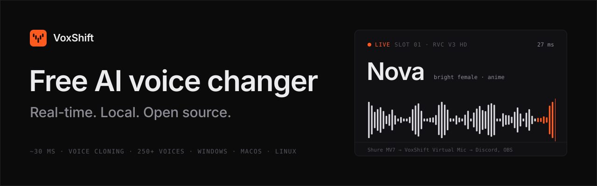
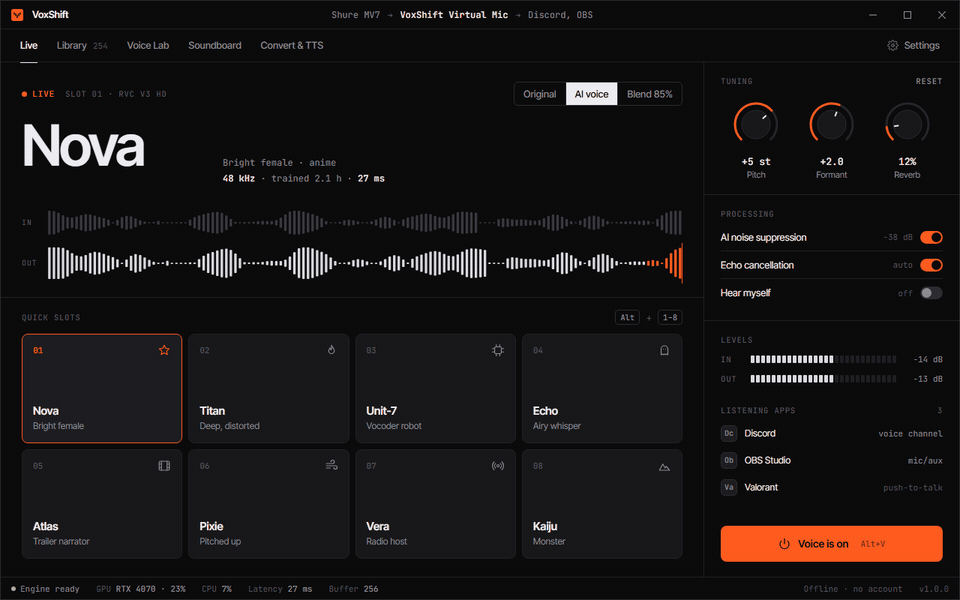
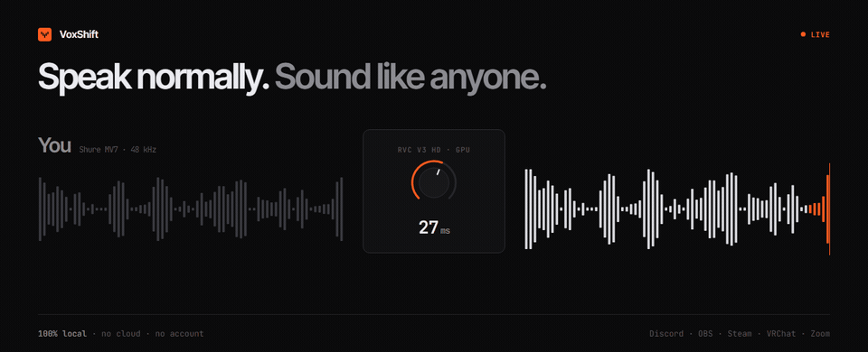
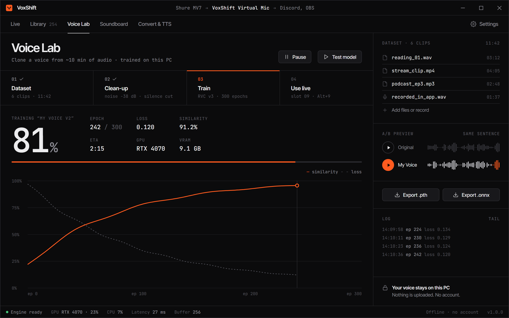
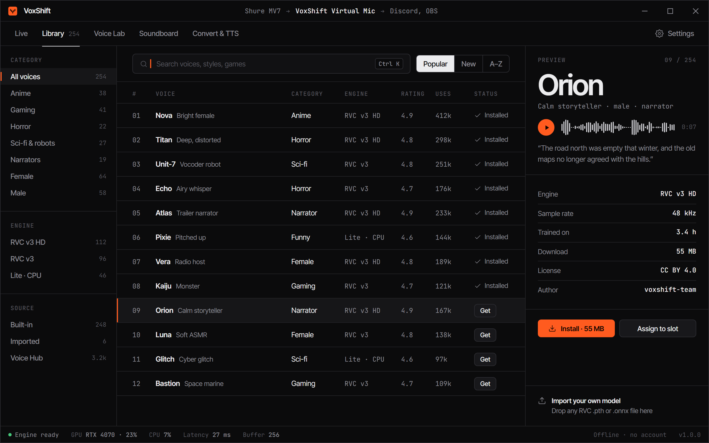
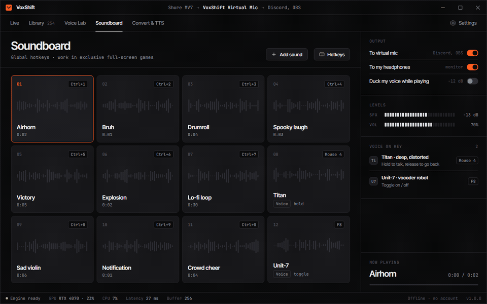
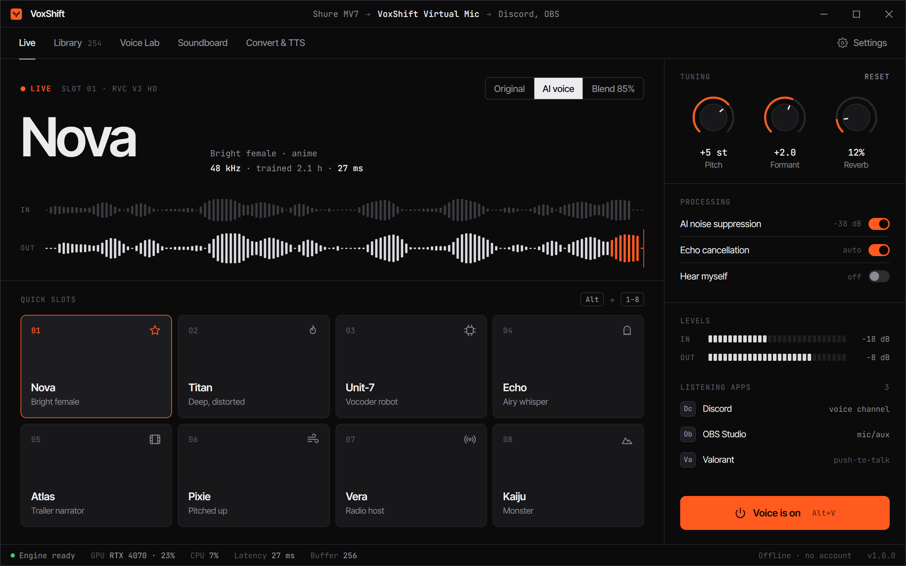
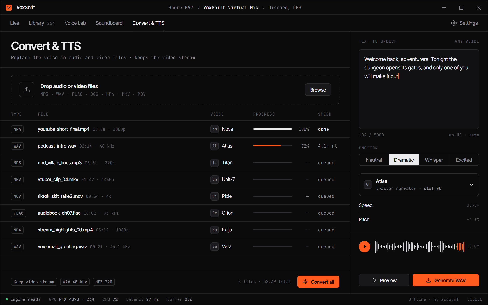
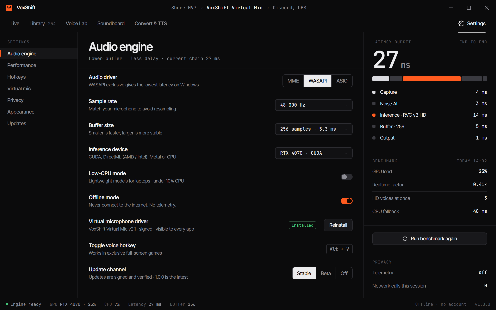
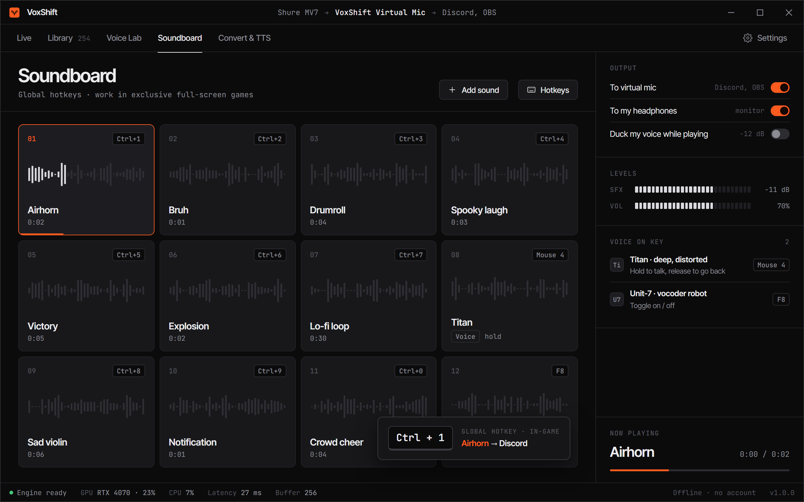

<a href="README.md">English</a> · <a href="README.es.md">Español</a> · <b>العربية</b> · <a href="README.hi.md">हिन्दी</a> · <a href="README.zh-CN.md">简体中文</a>

<h1>VoxShift — مغيّر صوت مجاني بالذكاء الاصطناعي لأنظمة Windows و macOS و Linux</h1>

<b>مغيّر صوت بالذكاء الاصطناعي في الوقت الفعلي</b> بزمن استجابة ~30 ms، مع <b>استنساخ الصوت محليًا</b>، و250+ صوتًا مجانيًا، ولوحة أصوات باختصارات لوحة المفاتيح، وميكروفون افتراضي يعمل في <b>Discord و OBS و Twitch و Zoom و Steam وكل الألعاب</b>. 
مجاني 100% · مفتوح المصدر · يعمل دون اتصال · بلا حساب · بلا إعلانات.

<a href="#killer-features">الميزات</a> ·
<a href="#download--install">التثبيت</a> ·
<a href="#voxshift-vs-voicemod-clownfish-morphvox-voiceai">المقارنة</a> ·
<a href="#faq">الأسئلة الشائعة</a>

VoxShift مغيّر صوت مجاني ومفتوح المصدر يعمل بالذكاء الاصطناعي على Windows و macOS و Linux، يغيّر صوتك في الوقت الفعلي (~30 ms) ويرسله إلى Discord و OBS و Twitch و Zoom والألعاب عبر ميكروفون افتراضي.

## نظرة سريعة

| | **VoxShift** |
|---|---|
| ما هو | مغيّر صوت بالذكاء الاصطناعي في الوقت الفعلي مع استنساخ صوت محلي ولوحة أصوات وميكروفون افتراضي |
| السعر | مجاني: بلا باقات مدفوعة أو إعلانات أو علامات مائية أو حدود زمنية |
| الرخصة | MIT (مفتوح المصدر) |
| المنصات | Windows 10 / 11 (x64, ARM64) · macOS 12+ (Apple Silicon و Intel) · Linux (AppImage، `.deb`، Flatpak) |
| العمل دون اتصال / البيانات | نعم. التحويل واستنساخ الصوت يعملان على جهازك؛ بلا حساب وبلا جمع بيانات استخدام (telemetry) |
| الميزات الرئيسية | تحويل صوت عصبي بزمن ~30 ms · استنساخ الصوت في Voice Lab من ~10 دقائق من التسجيلات · 250+ صوت · لوحة أصوات باختصارات تعمل داخل الألعاب · محوّل ملفات وتحويل النص إلى كلام (TTS) |
| بديل لـ | Voicemod و Clownfish و MorphVOX Pro و Voice.ai |
| الإصدار | 1.0.0 |

---

## جدول المحتويات

- [لماذا VoxShift؟](#why-voxshift)
- [الميزات الأبرز](#killer-features)
- [لقطات الشاشة](#screenshots)
- [التنزيل والتثبيت](#download--install)
- [البدء السريع (60 ثانية)](#quick-start-60-seconds)
- [VoxShift مقابل Voicemod و Clownfish و MorphVOX و Voice.ai](#voxshift-vs-voicemod-clownfish-morphvox-voiceai)
- [حالات الاستخدام](#use-cases)
- [الأسئلة الشائعة](#faq)
- [خارطة الطريق](#roadmap)
- [التقنيات المستخدمة](#built-with)
- [المساهمة](#contributing)
- [الرخصة والاستخدام المسؤول](#license--responsible-use)

## لماذا VoxShift؟

معظم مغيّرات الصوت "المجانية" إما مجرد أدوات لتغيير طبقة الصوت تُنتج صوتًا آليًا، أو مليئة بالإعلانات، أو تحبس الأصوات الجيدة خلف اشتراك مدفوع. **VoxShift مغيّر صوت عصبي يبدو بشريًا فعلًا — وهو مجاني.**

- **صوت حقيقي، لا آلي.** نماذج عصبية من فئة RVC تحوّل صوتك فعليًا بدل الاكتفاء بتغيير طبقته — فتبقى الأنفاس والمشاعر واللهجة كما هي.
- **سريع بما يكفي للألعاب التنافسية.** ~30 ms من البداية إلى النهاية على بطاقة رسوميات متوسطة الفئة، وأقل من 60 ms على الحواسيب المحمولة التي تعمل بالمعالج فقط.
- **الخصوصية في صميم التصميم.** كل شيء — بما في ذلك استنساخ الصوت — يعمل محليًا. بلا حساب، وبلا جمع بيانات استخدام، ويعمل دون اتصال بالكامل.
- **مجاني ومفتوح المصدر (MIT).** بلا علامات مائية، وبلا حدود زمنية، وبلا "أصوات بريميوم". كل الميزات موجودة في النسخة المجانية.

## الميزات الأبرز

<table>
<tr>
<td width="50%" valign="top">

### تحويل الصوت بالذكاء الاصطناعي في الوقت الفعلي
تحدّث بشكل طبيعي — يعيد VoxShift توليد صوتك بنموذج عصبي في الوقت الفعلي. يعرض **مقياس زمن الاستجابة** المباشر التأخير الكلي (عادةً **25–35 ms** مع CUDA أو DirectML أو Apple Metal)، ويتيح لك **مزج A/B** خلط صوتك الأصلي مع صوت الذكاء الاصطناعي.

</td>
<td width="50%"></td>
</tr>
<tr>
<td width="50%"></td>
<td width="50%" valign="top">

### Voice Lab — استنسخ صوتك محليًا
درّب **نموذج صوت مخصصًا بالذكاء الاصطناعي من ~10 دقائق من التسجيلات**. أضف تسجيلات أو حلقات بودكاست أو تسجيلات بثوثك السابقة — ينظّف VoxShift مجموعة البيانات (إزالة الضوضاء والصمت)، ويدرّب النموذج على بطاقة الرسوميات لديك، ويمنحك معاينة A/B. **صوتك لا يغادر جهازك أبدًا.** صدّره بصيغة `.pth` / `.onnx` أو شاركه في مركز المجتمع.

</td>
</tr>
<tr>
<td width="50%" valign="top">

### 250+ صوتًا مجانيًا بالذكاء الاصطناعي
فتاة أنمي، شيطان بصوت عميق، روبوت، شبح، راوي إعلانات أفلام، سنجاب، مذيع راديو، وحش، جندي فضاء، ASMR والمزيد — كلها مجانية وتعمل دون اتصال. تصفّح واستمع وثبّت بنقرة واحدة، أو استورد أي نموذج **RVC `.pth` / `.onnx`**. ويضيف **Voice Hub** آلاف الأصوات من المجتمع.

</td>
<td width="50%"></td>
</tr>
<tr>
<td width="50%"></td>
<td width="50%" valign="top">

### لوحة الأصوات + اختصارات الأصوات
لوحة أصوات مصممة للاعبين: **الاختصارات العامة تعمل داخل الألعاب بملء الشاشة**، والأصوات تصل إلى الميكروفون *والسماعات* معًا، ويمكن لأي زر أن **يبدّل الصوت** — اضغط مطوّلًا على <kbd>Mouse 4</kbd> لتتحدث بصوت شيطان، وأفلته لتعود إلى صوتك.

</td>
</tr>
<tr>
<td width="50%" valign="top">

### ميكروفون افتراضي — يعمل في أي تطبيق
نقرة واحدة تثبّت برنامج التشغيل الموقّع **VoxShift Virtual Mic**. اختره كجهاز إدخال في Discord أو OBS أو Zoom أو Teams أو Steam أو TeamSpeak أو VRChat أو Valorant أو CS2 أو Fortnite — دون الحاجة إلى Voicemeeter أو توجيه كابلات صوت افتراضية.

### إلغاء الضوضاء والصدى بالذكاء الاصطناعي
يزيل كبت الضوضاء العصبي نقرات لوحة المفاتيح وصوت المراوح وصدى الغرفة *قبل* التحويل، فيبقى صوت الذكاء الاصطناعي نقيًا — حتى مع ميكروفون سماعة رخيصة.

</td>
<td width="50%"></td>
</tr>
<tr>
<td width="50%"></td>
<td width="50%" valign="top">

### تغيير الصوت في الملفات وتحويل النص إلى كلام
غيّر الصوت دفعةً واحدة في ملفات **MP3 و WAV و FLAC و MP4 و MKV و MOV** — يبقى مسار الفيديو كما هو ويُستبدل الصوت فقط. أو اكتب نصًا وولّد **كلامًا (TTS) بأي صوت** وبالمشاعر التي تريدها (درامي، همس، حماس). مفيد لمقاطع YouTube Shorts و TikTok والدبلجة وجلسات D&D.

</td>
</tr>
<tr>
<td width="50%" valign="top">

### وضع استهلاك منخفض للمعالج، دون اتصال، بلا حساب
تُبقي النماذج الخفيفة استهلاك المعالج **أقل من 10%** على الحواسيب المحمولة والأجهزة القديمة. ويحظر وضع عدم الاتصال كل اتصالات الشبكة. بلا تسجيل، وبلا إعلانات، وبلا جمع بيانات استخدام — أبدًا.

</td>
<td width="50%"></td>
</tr>
</table>

## لقطات الشاشة

<table>
<tr>
<td></td>
<td></td>
<td></td>
</tr>
<tr>
<td align="center"><b>الصوت المباشر</b> — تحويل في الوقت الفعلي</td>
<td align="center"><b>مكتبة الأصوات</b> — 250+ صوت</td>
<td align="center"><b>Voice Lab</b> — استنسخ صوتك</td>
</tr>
<tr>
<td></td>
<td></td>
<td></td>
</tr>
<tr>
<td align="center"><b>لوحة الأصوات</b> — اختصارات عامة</td>
<td align="center"><b>المحوّل و TTS</b></td>
<td align="center"><b>الإعدادات</b> — WASAPI / ASIO</td>
</tr>
</table>

## التنزيل والتثبيت

| النظام | الحزمة | الأمر / الرابط |
|---|---|---|
| **Windows 10 / 11** (x64, ARM64) | مثبّت `.exe` · نسخة محمولة `.zip` | [VoxShift-Setup-1.0.0-x64.exe](https://github.com/ShardHazeGap/voxshift/releases/latest) |
| | winget | `winget install VoxShift.VoxShift` |
| | Scoop | `scoop bucket add extras && scoop install voxshift` |
| **macOS 12+** (Apple Silicon و Intel) | ملف `.dmg` شامل (Universal) | [VoxShift-1.0.0-universal.dmg](https://github.com/ShardHazeGap/voxshift/releases/latest) |
| | Homebrew | `brew install --cask voxshift` |
| **Linux** (x86_64) | AppImage · `.deb` · Flatpak | [VoxShift-1.0.0-x86_64.AppImage](https://github.com/ShardHazeGap/voxshift/releases/latest) · `flatpak install flathub app.voxshift.VoxShift` |

**متطلبات النظام**

| | الحد الأدنى (وضع Low-CPU) | الموصى به (أصوات HD، ~30 ms) |
|---|---|---|
| المعالج (CPU) | 4 أنوية، طراز 2015 أو أحدث | 6 أنوية أو أكثر |
| بطاقة الرسوميات (GPU) | غير مطلوبة | NVIDIA GTX 1660 / RTX 20xx+، AMD RX 6000+ (DirectML)، Apple M1+ |
| الذاكرة (RAM) | 4 GB | 8 GB+ |
| التدريب في Voice Lab | — | 6 GB+ VRAM (NVIDIA) أو Apple M-series |

> كل إصدار موقّع رقميًا ويأتي مع مجاميع تحقق SHA-256. نزّل فقط من [GitHub Releases](https://github.com/ShardHazeGap/voxshift/releases).

## البدء السريع (60 ثانية)

1. **ثبّت VoxShift وشغّله** — يثبّت معالج الإعداد برنامج تشغيل الميكروفون الافتراضي ويختبر أداء بطاقة الرسوميات لديك.
2. **اختر صوتًا** في *Live Voice* (أو اضغط <kbd>Alt</kbd> + <kbd>1</kbd>…<kbd>8</kbd>) ثم اضغط **Voice ON**.
3. **في Discord أو OBS أو لعبتك** اضبط جهاز الإدخال على **`VoxShift Virtual Mic`**. وهذا كل شيء.

<b>إعداد Discord خطوة بخطوة</b>

1. افتح Discord ثم *User Settings* ثم *Voice & Video*.
2. اختر `VoxShift Virtual Mic` في **Input Device**.
3. **أوقف** خياري *Noise Suppression* و *Echo Cancellation* في Discord (فالذكاء الاصطناعي في VoxShift يقوم بذلك بشكل أفضل).
4. اضبط *Input Sensitivity* على الوضع التلقائي. تحدّث — وسيسمع أصدقاؤك صوت الذكاء الاصطناعي.

<b>إعداد OBS / Streamlabs</b>

في *Sources* أضف *Audio Input Capture* واختر الجهاز `VoxShift Virtual Mic`. اكتم مصدر الميكروفون الأصلي لتجنّب تكرار الصوت.

## VoxShift مقابل Voicemod و Clownfish و MorphVOX و Voice.ai

| | **VoxShift** | Voicemod | Clownfish | MorphVOX Pro | Voice.ai |
|---|:---:|:---:|:---:|:---:|:---:|
| السعر | **مجاني (MIT)** | مجاني جزئيًا / اشتراك | مجاني | مدفوع | مجاني جزئيًا |
| أصوات عصبية بالذكاء الاصطناعي (لا مجرد تغيير طبقة) | ✓ | Pro | — | — | ✓ |
| استنساخ صوتك **محليًا** | ✓ | — | — | — | سحابي |
| يعمل دون اتصال وبلا حساب | ✓ | — | ✓ | ✓ | — |
| مفتوح المصدر | ✓ | — | — | — | — |
| لوحة أصوات مدمجة + اختصارات للأصوات | ✓ | ✓ | — | جزئي | — |
| تغيير الصوت في ملفات الصوت/الفيديو | ✓ | — | — | جزئي | جزئي |
| تحويل النص إلى كلام بأي صوت | ✓ | جزئي | ✓ | — | — |
| استيراد نماذج RVC `.pth` / `.onnx` | ✓ | — | — | — | جزئي |
| macOS و Linux | ✓ | macOS | — | — | — |
| إعلانات / عروض ترقية مدفوعة | **لا يوجد** | نعم | لا | نعم | نعم |

**تبحث عن بديل مجاني لـ Voicemod؟** VoxShift بديل مجاني ومفتوح المصدر لـ Voicemod و Clownfish و MorphVOX Pro و Voice.ai — ومع الميكروفون الافتراضي المدمج لن تحتاج إلى Voicemeeter أيضًا.

المقارنة مبنية على المعلومات المتاحة للعامة حتى الإصدار v1.0.0. العلامات التجارية مملوكة لأصحابها. وجدت خطأ؟ [افتح بلاغًا (issue)](https://github.com/ShardHazeGap/voxshift/issues).

## حالات الاستخدام

### مغيّر صوت لـ Discord
استخدم VoxShift كجهاز إدخال في Discord وبدّل الأصوات أثناء المكالمة باختصارات لوحة المفاتيح. يعمل في القنوات الصوتية وقنوات Stage والرسائل الخاصة، ومع لوحة أصوات Discord جنبًا إلى جنب مع لوحة VoxShift.

### مغيّر صوت للبث المباشر (OBS و Twitch و YouTube و Kick)
ابثّ بشخصية دون أن تُظهر وجهك — مثالي **لصنّاع البث الذين لا يُظهرون وجوههم ولـ VTubers**. اربط الأصوات والمؤثرات بـ Stream Deck أو باختصارات، ووجّه الميكروفون الافتراضي إلى OBS.

### مغيّر صوت للألعاب (Valorant و CS2 و Fortnite و Apex و GTA RP)
تعمل الاختصارات العامة في وضع ملء الشاشة الحصري. وزمن الاستجابة المنخفض يعني أن نداءاتك لفريقك تصل في وقتها. اضغط مطوّلًا على زر للتحول إلى صوت شيطان في لحظة الحسم. ويستخدم لاعبو GTA V RP برنامج VoxShift للحفاظ على صوت ثابت لشخصياتهم.

### مغيّر صوت لـ VRChat و VTubers
اجمع بين الأفاتار الخاص بك وصوت أنمي لطيف أو صوت وحش عميق. استنسخ صوت شخصيتك في Voice Lab واستخدمه بشكل ثابت في VRChat و Twitch و TikTok.

### لصنّاع المحتوى ومقدّمي البودكاست والدبلجة
حوّل التعليقات الصوتية دفعةً واحدة، وأخفِ هوية ضيوف المقابلات، وأنشئ أصواتًا للشخصيات في الرسوم المتحركة و YouTube Shorts و TikTok، أو ولّد سردًا صوتيًا بتحويل النص إلى كلام.

## الأسئلة الشائعة

<b>هل VoxShift مجاني فعلًا؟</b>

نعم. VoxShift مجاني ومفتوح المصدر بموجب رخصة MIT. لا توجد باقات مدفوعة ولا إعلانات ولا علامات مائية ولا حدود زمنية. يمكنك دعم التطوير عبر GitHub Sponsors.

<b>كيف أغيّر صوتي على Discord مجانًا؟</b>

ثبّت VoxShift، واختر صوتًا، وانقر **Voice ON**، ثم في إعدادات Voice & Video في Discord اضبط جهاز الإدخال على **VoxShift Virtual Mic**. راجع [إعداد Discord](#quick-start-60-seconds).

<b>هل هو مغيّر صوت في الوقت الفعلي؟ وكم يبلغ زمن الاستجابة؟</b>

نعم. يبلغ زمن الاستجابة الكلي المعتاد 25–35 ms على بطاقات NVIDIA RTX / AMD RX 6000 / Apple M1، و45–60 ms في وضع Low-CPU. ويعرض مقياس زمن الاستجابة في التطبيق رقمك الدقيق.

<b>هل يمكنني استنساخ صوتي؟ وهل ذلك آمن؟</b>

نعم — يدرّب Voice Lab نموذجًا من نحو 10 دقائق من تسجيلات صوتك. يجري التدريب والاستدلال بالكامل على جهازك، ولا يُرفع أي شيء. لا تستنسخ إلا الأصوات التي تملكها أو لديك إذن صريح باستخدامها.

<b>هل يعمل VoxShift بدون بطاقة رسوميات؟</b>

نعم. يستخدم وضع Low-CPU نماذج خفيفة تعمل على أي معالج حديث رباعي النوى باستهلاك أقل من 10%. وتتيح بطاقة الرسوميات أصوات HD وزمن استجابة أقل.

<b>هل سيتسبب مغيّر الصوت في حظري في Valorant أو CS2 أو Fortnite؟</b>

لا. لا يلمس VoxShift عملية اللعبة (process) — فهو جهاز إدخال صوتي قياسي، تمامًا مثل ميكروفون USB. وهو ليس مصدر قلق من ناحية أنظمة مكافحة الغش.

<b>هل يمكنني استخدام نماذج RVC من الإنترنت؟</b>

نعم. استورد أي نموذج RVC v1/v2 بصيغة `.pth` أو `.onnx` عبر *Voice Library → Import*. واحترم رخصة كل نموذج.

<b>هل يعمل على macOS و Linux؟</b>

نعم. يعمل على macOS 12+ (تستخدم أجهزة Apple Silicon تسريع Metal) وعلى Linux عبر AppImage أو `.deb` أو Flatpak (مصدر صوت افتراضي عبر PipeWire / PulseAudio).

<b>هل VoxShift بديل لـ Voicemod؟</b>

نعم — يغطي VoxShift الميزات الأساسية في Voicemod (أصوات في الوقت الفعلي، لوحة أصوات، اختصارات، ميكروفون افتراضي) ويضيف استنساخ الصوت محليًا وتحويل الملفات و TTS، مجانًا وبلا حساب.

<b>كيف أغيّر الصوت في ملف فيديو؟</b>

افتح *Converter & TTS*، وأفلت ملف MP4/MKV/MOV، واختر صوتًا، ثم انقر **Convert all**. يحتفظ VoxShift بالفيديو الأصلي ويستبدل مسار الصوت فقط.

## خارطة الطريق

- [x] محرك RVC v3 في الوقت الفعلي (CUDA و DirectML و Metal و CPU)
- [x] Voice Lab — استنساخ الصوت محليًا
- [x] لوحة أصوات باختصارات عامة وتبديل الصوت لكل زر
- [x] محوّل الملفات + تحويل النص إلى كلام
- [ ] إضافة لـ Stream Deck و Touch Portal
- [ ] وضع الغناء في الوقت الفعلي (بدقة في طبقة الصوت)
- [ ] تطبيق مرافق على Android (لوحة أصوات عن بُعد)
- [ ] استنساخ الصوت دون تدريب مسبق (zero-shot) من 10 ثوانٍ من الصوت
- [ ] وضع الترجمة — تحدّث بالإنجليزية وسيبدو صوتك كأنك تتحدث اليابانية

صوّت على الميزات في [Discussions](https://github.com/ShardHazeGap/voxshift/discussions).

## التقنيات المستخدمة

مصدر تصميم الواجهة موجود في `design/` — وكل لقطة شاشة وصورة GIF في هذا الملف مولَّدة منه.

## المساهمة

نرحّب بطلبات الدمج (PRs) والأصوات الجديدة والترجمات. اقرأ [CONTRIBUTING.md](CONTRIBUTING.md)، واختر مهمة من [`good first issue`](https://github.com/ShardHazeGap/voxshift/labels/good%20first%20issue)، وانضم إلينا على [Discord](https://github.com/DISCORD_INVITE).

### سجل النجوم

## الرخصة والاستخدام المسؤول

يُصدَر VoxShift بموجب [رخصة MIT](LICENSE).

تغيير الصوت واستنساخه أداتان قويتان. **لا** تستخدم VoxShift لانتحال شخصية أشخاص حقيقيين دون موافقتهم، أو لارتكاب الاحتيال، أو لمضايقة الآخرين، أو لتجاوز أنظمة المصادقة القائمة على الصوت. لا تستنسخ إلا الأصوات التي تملكها أو لديك إذن صريح باستخدامها. وأنت مسؤول عن الالتزام بقوانين بلدك.

---

**إذا كان VoxShift مفيدًا لك، فامنح المستودع نجمة. فهذا يساعد الآخرين على العثور على مغيّر صوت مجاني.**

الكلمات المفتاحية: مغير صوت مجاني · مغير صوت بالذكاء الاصطناعي · تغيير الصوت في الوقت الفعلي · مغير صوت ديسكورد · برنامج تغيير الصوت للكمبيوتر · تغيير الصوت إلى صوت بنت · مغير صوت RVC · استنساخ الصوت · مغير صوت أنمي · لوحة أصوات · بديل Voicemod · voice changer · مغير صوت مفتوح المصدر لـ Windows و macOS و Linux

