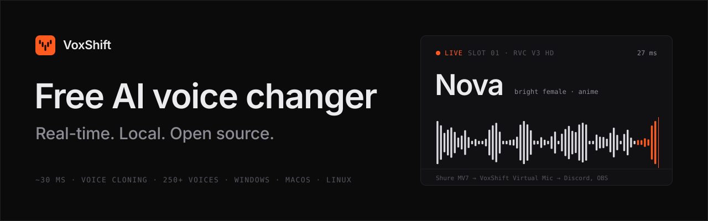
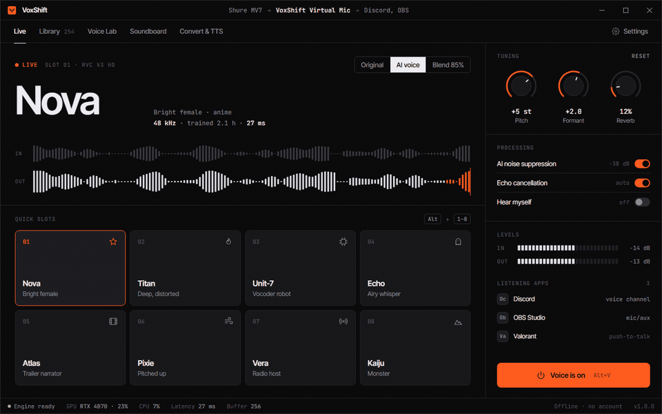
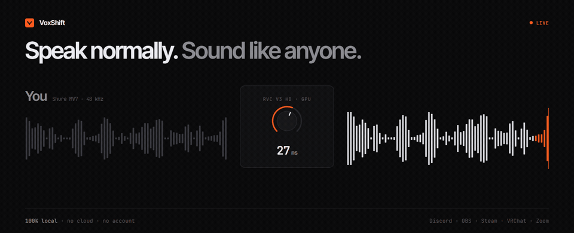
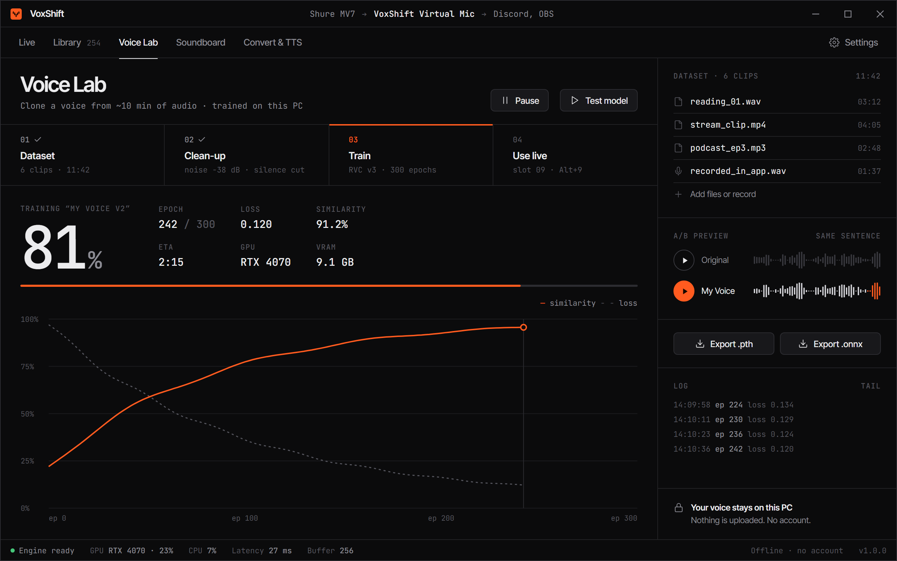
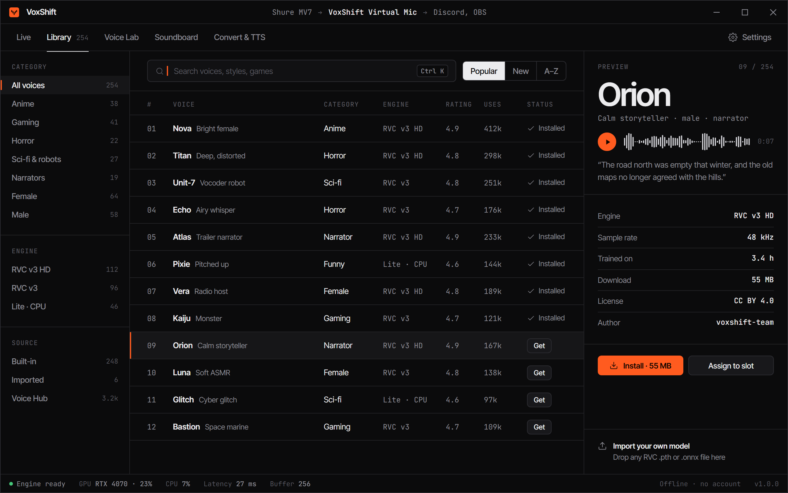
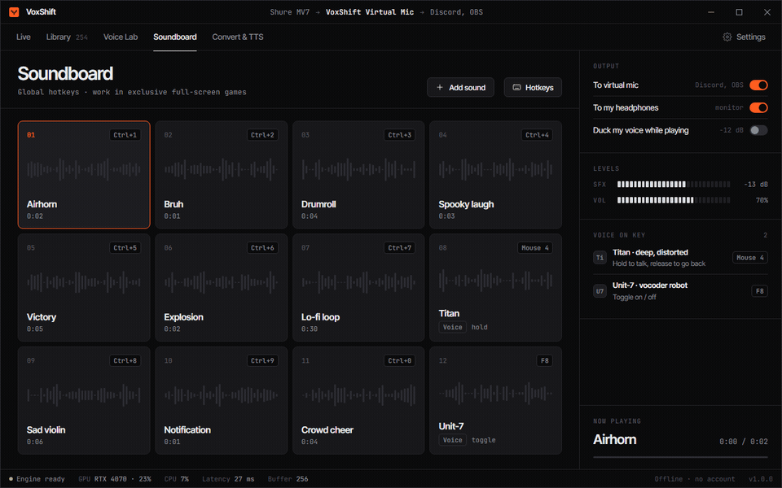
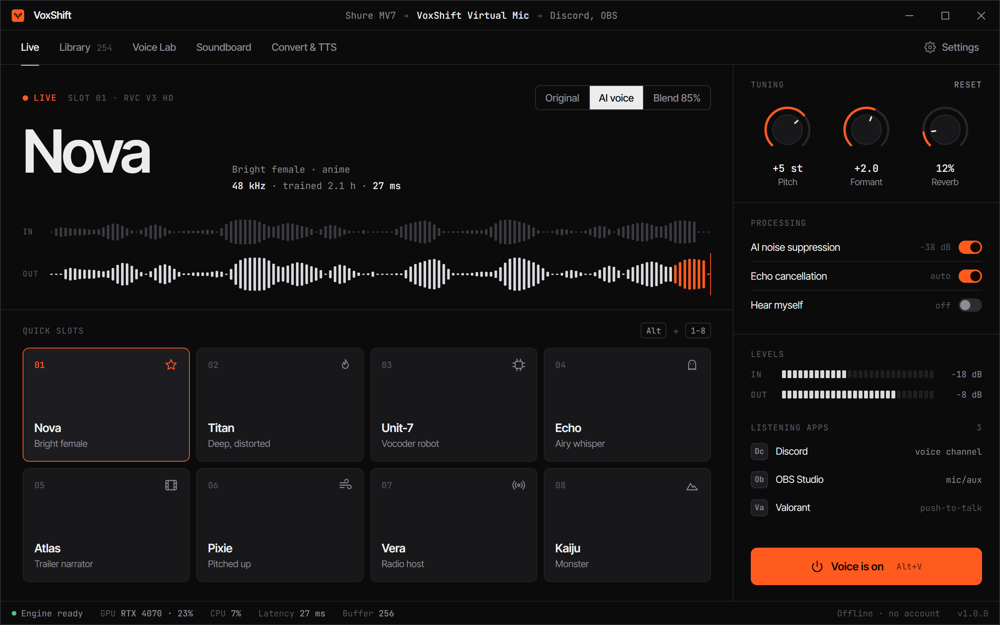
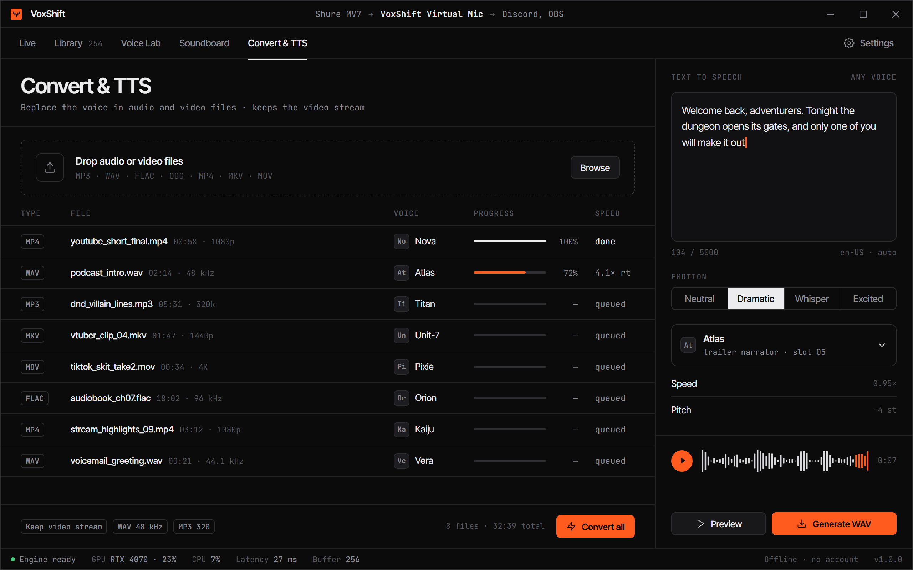
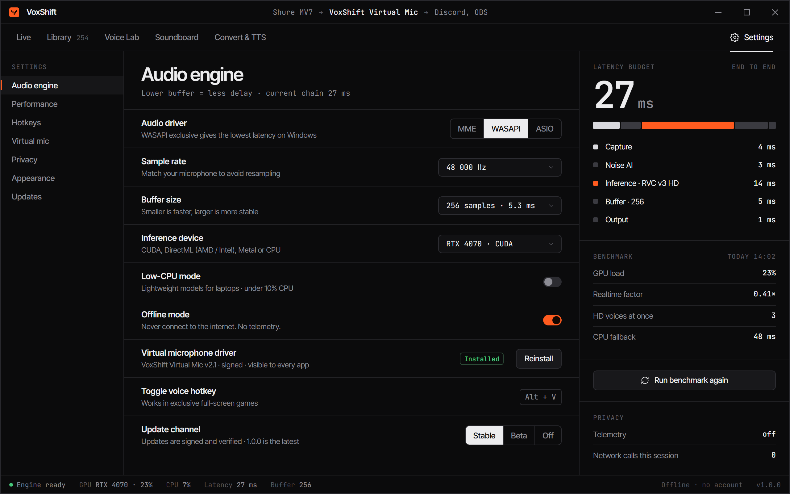
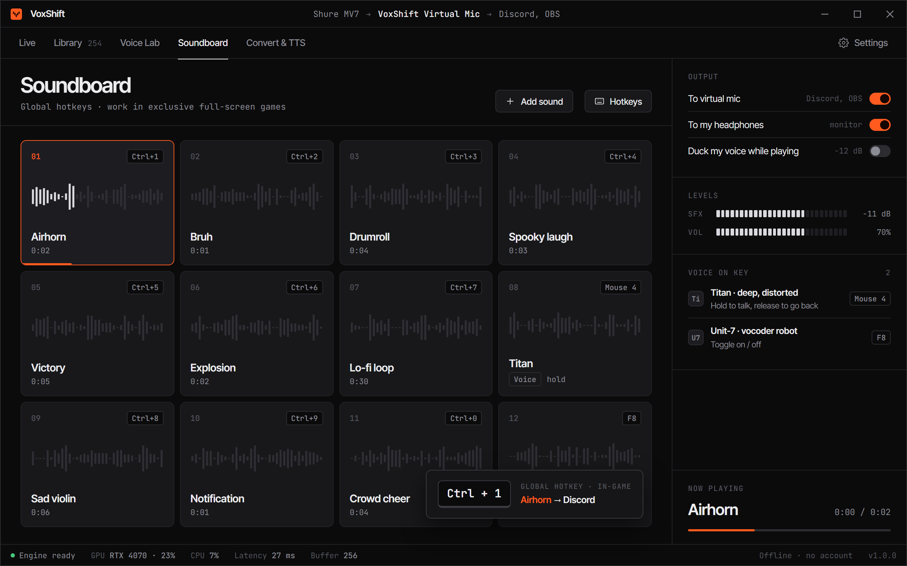

<h1>VoxShift — Cambiador de voz con IA gratis para Windows, macOS y Linux</h1>

<b>Cambiador de voz con IA en tiempo real</b> con ~30 ms de latencia, <b>clonación de voz local</b>, más de 250 voces gratis, un soundboard con atajos de teclado y un micrófono virtual que funciona en <b>Discord, OBS, Twitch, Zoom, Steam y cualquier juego</b>. 
100 % gratis · código abierto · funciona sin conexión · sin cuenta · sin anuncios.

<a href="README.md">English</a> · <b>Español</b> · <a href="README.ar.md">العربية</a> · <a href="README.hi.md">हिन्दी</a> · <a href="README.zh-CN.md">简体中文</a> &nbsp;|&nbsp;
<a href="#funciones-destacadas">Funciones</a> ·
<a href="#descarga-e-instalación">Instalación</a> ·
<a href="#voxshift-vs-voicemod-clownfish-morphvox-voiceai">Comparativa</a> ·
<a href="#preguntas-frecuentes">Preguntas frecuentes</a>

VoxShift es un cambiador de voz con IA gratuito y de código abierto para Windows, macOS y Linux que cambia tu voz en tiempo real (~30 ms) y la envía a Discord, OBS, Twitch, Zoom y juegos mediante un micrófono virtual.

## De un vistazo

| | **VoxShift** |
|---|---|
| Qué es | Cambiador de voz con IA en tiempo real con clonación de voz local, soundboard y micrófono virtual |
| Precio | Gratis: sin planes de pago, anuncios, marcas de agua ni límites de tiempo |
| Licencia | MIT (código abierto) |
| Plataformas | Windows 10 / 11 (x64, ARM64) · macOS 12+ (Apple Silicon e Intel) · Linux (AppImage, `.deb`, Flatpak) |
| Sin conexión / datos | Sí. La conversión y la clonación de voz se ejecutan en tu PC; sin cuenta, sin telemetría |
| Funciones principales | Conversión de voz neuronal de ~30 ms · clonación en Voice Lab a partir de ~10 min de audio · más de 250 voces · soundboard con atajos dentro del juego · conversor de archivos y TTS |
| Alternativa a | Voicemod, Clownfish, MorphVOX Pro, Voice.ai |
| Versión | 1.0.0 |

---

## Índice

- [¿Por qué VoxShift?](#por-qué-voxshift)
- [Funciones destacadas](#funciones-destacadas)
- [Capturas de pantalla](#capturas-de-pantalla)
- [Descarga e instalación](#descarga-e-instalación)
- [Inicio rápido (60 segundos)](#inicio-rápido-60-segundos)
- [VoxShift vs Voicemod, Clownfish, MorphVOX, Voice.ai](#voxshift-vs-voicemod-clownfish-morphvox-voiceai)
- [Casos de uso](#casos-de-uso)
- [Preguntas frecuentes](#preguntas-frecuentes)
- [Hoja de ruta](#hoja-de-ruta)
- [Tecnologías](#tecnologías)
- [Cómo contribuir](#cómo-contribuir)
- [Licencia y uso responsable](#licencia-y-uso-responsable)

## ¿Por qué VoxShift?

La mayoría de los cambiadores de voz "gratis" son simples moduladores de tono que suenan robóticos, tienen anuncios o esconden las buenas voces detrás de una suscripción. **VoxShift es un cambiador de voz neuronal que de verdad suena humano, y es gratis.**

- **Suena real, no robótico.** Los modelos neuronales tipo RVC convierten tu voz, no solo le cambian el tono: se conservan la respiración, la emoción y el acento.
- **Lo bastante rápido para juegos competitivos.** ~30 ms de extremo a extremo en una GPU de gama media, menos de 60 ms en laptops solo con CPU.
- **Privado por diseño.** Todo, incluida la clonación de voz, se ejecuta localmente. Sin cuenta, sin telemetría, funciona completamente sin conexión.
- **Gratis y de código abierto (MIT).** Sin marcas de agua, sin límites de tiempo, sin "voces premium". Todas las funciones están en la versión gratuita.

## Funciones destacadas

<table>
<tr>
<td width="50%" valign="top">

### Conversión de voz con IA en tiempo real
Habla con normalidad: VoxShift vuelve a sintetizar tu voz con un modelo neuronal en tiempo real. Un **medidor de latencia** en vivo muestra el retraso de extremo a extremo (normalmente **25–35 ms** con CUDA, DirectML o Apple Metal), y la **mezcla A/B** te permite combinar tu voz original con la voz de IA.

</td>
<td width="50%"></td>
</tr>
<tr>
<td width="50%"></td>
<td width="50%" valign="top">

### Voice Lab: clona tu propia voz localmente
Entrena un **modelo de voz con IA personalizado a partir de ~10 minutos de audio**. Arrastra grabaciones, podcasts o VODs de tus transmisiones: VoxShift limpia el conjunto de datos (elimina ruido y silencios), entrena en tu GPU y te ofrece una vista previa A/B. **Tu voz nunca sale de tu PC.** Exporta como `.pth` / `.onnx` o compártela en el hub de la comunidad.

</td>
</tr>
<tr>
<td width="50%" valign="top">

### Más de 250 voces de IA gratis
Chica anime, demonio grave, robot, fantasma, narrador de tráiler de película, ardilla, locutor de radio, monstruo, marine espacial, ASMR y más: todas gratis, todas sin conexión. Explora, escucha e instala con un clic, o importa cualquier modelo **RVC `.pth` / `.onnx`**. El **Voice Hub** suma miles de voces de la comunidad.

</td>
<td width="50%"></td>
</tr>
<tr>
<td width="50%"></td>
<td width="50%" valign="top">

### Soundboard + atajos de voz
Un soundboard hecho para gamers: los **atajos globales funcionan dentro de juegos en pantalla completa**, los sonidos van a tu micrófono *y* a tus audífonos, y cualquier tecla puede **cambiar de voz**: mantén <kbd>Mouse 4</kbd> para hablar como un demonio y suéltala para volver.

</td>
</tr>
<tr>
<td width="50%" valign="top">

### Micrófono virtual: funciona en cualquier app
Un clic instala el controlador firmado **VoxShift Virtual Mic**. Selecciónalo como dispositivo de entrada en Discord, OBS, Zoom, Teams, Steam, TeamSpeak, VRChat, Valorant, CS2 o Fortnite, sin necesidad de Voicemeeter ni de enrutar cables virtuales.

### Supresión de ruido y eco con IA
La supresión de ruido neuronal elimina los clics del teclado, los ventiladores y el eco de la habitación *antes* de la conversión, para que la voz de IA se mantenga limpia, incluso con el micrófono de unos audífonos baratos.

</td>
<td width="50%"></td>
</tr>
<tr>
<td width="50%"></td>
<td width="50%" valign="top">

### Conversor de voz en archivos y texto a voz
Cambia la voz por lotes en archivos **MP3, WAV, FLAC, MP4, MKV y MOV**: la pista de video se mantiene intacta y solo se reemplaza la voz. O escribe un texto y genera **TTS con cualquier voz** y emoción (dramática, susurro, emocionada). Útil para YouTube Shorts, TikTok, doblaje y partidas de D&D.

</td>
</tr>
<tr>
<td width="50%" valign="top">

### Modo Low-CPU, sin conexión, sin cuenta
Los modelos ligeros mantienen el uso de CPU **por debajo del 10 %** en laptops y PCs antiguas. El modo sin conexión bloquea todas las conexiones de red. Sin registro, sin anuncios, sin telemetría. Nunca.

</td>
<td width="50%"></td>
</tr>
</table>

## Capturas de pantalla

<table>
<tr>
<td></td>
<td></td>
<td></td>
</tr>
<tr>
<td align="center"><b>Live Voice</b>: conversión en tiempo real</td>
<td align="center"><b>Voice Library</b>: más de 250 voces</td>
<td align="center"><b>Voice Lab</b>: clona tu voz</td>
</tr>
<tr>
<td></td>
<td></td>
<td></td>
</tr>
<tr>
<td align="center"><b>Soundboard</b>: atajos globales</td>
<td align="center"><b>Converter &amp; TTS</b></td>
<td align="center"><b>Settings</b>: WASAPI / ASIO</td>
</tr>
</table>

## Descarga e instalación

| Sistema | Paquete | Comando / enlace |
|---|---|---|
| **Windows 10 / 11** (x64, ARM64) | Instalador `.exe` · Portable `.zip` | [VoxShift-Setup-1.0.0-x64.exe](https://github.com/ShardHazeGap/voxshift/releases/latest) |
| | winget | `winget install VoxShift.VoxShift` |
| | Scoop | `scoop bucket add extras && scoop install voxshift` |
| **macOS 12+** (Apple Silicon e Intel) | `.dmg` universal | [VoxShift-1.0.0-universal.dmg](https://github.com/ShardHazeGap/voxshift/releases/latest) |
| | Homebrew | `brew install --cask voxshift` |
| **Linux** (x86_64) | AppImage · `.deb` · Flatpak | [VoxShift-1.0.0-x86_64.AppImage](https://github.com/ShardHazeGap/voxshift/releases/latest) · `flatpak install flathub app.voxshift.VoxShift` |

**Requisitos del sistema**

| | Mínimo (modo Low-CPU) | Recomendado (voces HD, ~30 ms) |
|---|---|---|
| CPU | 4 núcleos, 2015 o posterior | 6 núcleos o más |
| GPU | no es necesaria | NVIDIA GTX 1660 / RTX 20xx+, AMD RX 6000+ (DirectML), Apple M1+ |
| RAM | 4 GB | 8 GB o más |
| Entrenamiento en Voice Lab | — | 6 GB+ de VRAM (NVIDIA) o Apple serie M |

> Cada versión está firmada e incluye sumas de verificación SHA-256. Descarga solo desde [GitHub Releases](https://github.com/ShardHazeGap/voxshift/releases).

## Inicio rápido (60 segundos)

1. **Instala y abre VoxShift**: el asistente de instalación instala el controlador del micrófono virtual y evalúa el rendimiento de tu GPU.
2. **Elige una voz** en *Live Voice* (o presiona <kbd>Alt</kbd> + <kbd>1</kbd>…<kbd>8</kbd>) y pulsa **Voice ON**.
3. **En Discord / OBS / tu juego**, configura el dispositivo de entrada como **`VoxShift Virtual Mic`**. Listo.

<b>Configuración de Discord paso a paso</b>

1. Discord → *Ajustes de usuario* → *Voz y video*.
2. **Dispositivo de entrada** → `VoxShift Virtual Mic`.
3. **Desactiva** la *Supresión de ruido* y la *Cancelación de eco* de Discord (la IA de VoxShift ya lo hace mejor).
4. Configura la *Sensibilidad de entrada* en automático. Habla: tus amigos escucharán la voz de IA.

<b>Configuración de OBS / Streamlabs</b>

*Fuentes* → *Captura de entrada de audio* → dispositivo `VoxShift Virtual Mic`. Silencia la fuente de tu micrófono original para evitar que la voz se duplique.

## VoxShift vs Voicemod, Clownfish, MorphVOX, Voice.ai

| | **VoxShift** | Voicemod | Clownfish | MorphVOX Pro | Voice.ai |
|---|:---:|:---:|:---:|:---:|:---:|
| Precio | **Gratis (MIT)** | Freemium / suscripción | Gratis | De pago | Freemium |
| Voces neuronales con IA (no solo cambio de tono) | ✓ | Pro | — | — | ✓ |
| Clona tu propia voz **localmente** | ✓ | — | — | — | en la nube |
| Funciona sin conexión y sin cuenta | ✓ | — | ✓ | ✓ | — |
| Código abierto | ✓ | — | — | — | — |
| Soundboard integrado + atajos de voz | ✓ | ✓ | — | parcial | — |
| Cambio de voz en archivos de audio/video | ✓ | — | — | parcial | parcial |
| Texto a voz con cualquier voz | ✓ | parcial | ✓ | — | — |
| Importa modelos RVC `.pth` / `.onnx` | ✓ | — | — | — | parcial |
| macOS y Linux | ✓ | macOS | — | — | — |
| Anuncios / ventas adicionales | **Ninguno** | Sí | No | Sí | Sí |

**¿Buscas una alternativa gratis a Voicemod?** VoxShift es una alternativa gratuita y de código abierto a Voicemod, Clownfish, MorphVOX Pro y Voice.ai, y con su micrófono virtual integrado tampoco necesitas Voicemeeter.

Comparativa basada en información pública disponible a la fecha de la v1.0.0. Las marcas registradas pertenecen a sus respectivos dueños. ¿Encontraste un error? [Abre un issue](https://github.com/ShardHazeGap/voxshift/issues).

## Casos de uso

### Cambiador de voz para Discord
Usa VoxShift como dispositivo de entrada en Discord y cambia de voz en plena llamada con atajos de teclado. Funciona en canales de voz, Escenarios, mensajes directos y con el soundboard de Discord junto al de VoxShift.

### Cambiador de voz para streaming (OBS, Twitch, YouTube, Kick)
Transmite como un personaje sin mostrar tu cara: perfecto para **streamers sin cámara y VTubers**. Asigna voces y sonidos al Stream Deck o a atajos de teclado y envía el micrófono virtual a OBS.

### Cambiador de voz para juegos (Valorant, CS2, Fortnite, Apex, GTA RP)
Los atajos globales funcionan en pantalla completa exclusiva. La baja latencia hace que tus callouts lleguen a tiempo. Mantén una tecla para cambiar a voz de demonio en ese momento clutch. Los jugadores de GTA V RP usan VoxShift para mantener una voz de personaje constante.

### Cambiador de voz para VRChat y VTubers
Combina una voz anime tierna o una voz grave de monstruo con tu avatar. Clona la voz de tu personaje en Voice Lab y úsala de forma constante en VRChat, Twitch y TikTok.

### Para creadores de contenido, podcasters y doblaje
Convierte locuciones por lotes, anonimiza a los invitados de tus entrevistas, crea voces de personajes para animaciones, YouTube Shorts y TikTok, o genera narraciones con texto a voz.

## Preguntas frecuentes

<b>¿VoxShift es realmente gratis?</b>

Sí. VoxShift es gratuito y de código abierto bajo la licencia MIT. No tiene planes de pago, anuncios, marcas de agua ni límites de tiempo. Puedes apoyar el desarrollo a través de GitHub Sponsors.

<b>¿Cómo cambio mi voz en Discord gratis?</b>

Instala VoxShift, elige una voz, haz clic en **Voice ON** y luego, en Discord → Voz y video, configura el dispositivo de entrada como **VoxShift Virtual Mic**. Consulta la [configuración de Discord](#inicio-rápido-60-segundos).

<b>¿Es un cambiador de voz en tiempo real? ¿Cuánta latencia tiene?</b>

Sí. La latencia típica de extremo a extremo es de 25–35 ms en una GPU NVIDIA RTX / AMD RX 6000 / Apple M1 y de 45–60 ms en modo Low-CPU. El medidor de latencia de la app muestra tu cifra exacta.

<b>¿Puedo clonar mi propia voz? ¿Es seguro?</b>

Sí: Voice Lab entrena un modelo a partir de unos 10 minutos de tu audio. El entrenamiento y la inferencia se ejecutan por completo en tu PC; no se sube nada. Clona solo voces que te pertenezcan o que tengas permiso explícito para usar.

<b>¿VoxShift funciona sin GPU?</b>

Sí. El modo Low-CPU usa modelos ligeros que funcionan en cualquier CPU moderna de 4 núcleos con menos del 10 % de uso. Una GPU habilita las voces HD y una latencia más baja.

<b>¿Me pueden banear en Valorant, CS2 o Fortnite por usar un cambiador de voz?</b>

No. VoxShift no toca el proceso del juego: es un dispositivo de entrada de audio estándar, igual que un micrófono USB. No es un problema para el anti-cheat.

<b>¿Puedo usar modelos RVC de internet?</b>

Sí. Importa cualquier modelo RVC v1/v2 `.pth` u `.onnx` desde *Voice Library → Import*. Respeta la licencia de cada modelo.

<b>¿Funciona en macOS y Linux?</b>

Sí. macOS 12+ (en Apple Silicon usa aceleración Metal) y Linux mediante AppImage, `.deb` o Flatpak (fuente virtual de PipeWire / PulseAudio).

<b>¿VoxShift es una alternativa a Voicemod?</b>

Sí: VoxShift cubre las funciones principales de Voicemod (voces en tiempo real, soundboard, atajos de teclado, micrófono virtual) y añade clonación de voz local, conversión de archivos y TTS, gratis y sin cuenta.

<b>¿Cómo cambio la voz en un archivo de video?</b>

Abre *Converter & TTS*, arrastra un archivo MP4/MKV/MOV, elige una voz y haz clic en **Convert all**. VoxShift conserva el video original y reemplaza solo la pista de voz.

## Hoja de ruta

- [x] Motor RVC v3 en tiempo real (CUDA, DirectML, Metal, CPU)
- [x] Voice Lab: clonación de voz local
- [x] Soundboard con atajos globales y cambio de voz por tecla
- [x] Conversor de archivos + texto a voz
- [ ] Plugin para Stream Deck y Touch Portal
- [ ] Modo de canto en tiempo real (con afinación precisa)
- [ ] App complementaria para Android (soundboard remoto)
- [ ] Clonación de voz zero-shot a partir de 10 segundos de audio
- [ ] Modo traducción: habla en inglés y suena como si hablaras japonés

Vota por las funciones en [Discussions](https://github.com/ShardHazeGap/voxshift/discussions).

## Tecnologías

El código fuente del diseño de la interfaz está en `design/`: todas las capturas y GIFs de este README se generan a partir de él.

## Cómo contribuir

Los PRs, las voces nuevas y las traducciones son bienvenidos. Lee [CONTRIBUTING.md](CONTRIBUTING.md), elige un [`good first issue`](https://github.com/ShardHazeGap/voxshift/labels/good%20first%20issue) y únete a nosotros en [Discord](https://github.com/DISCORD_INVITE).

### Historial de estrellas

## Licencia y uso responsable

VoxShift se publica bajo la [licencia MIT](LICENSE).

El cambio y la clonación de voz son herramientas poderosas. **No** uses VoxShift para suplantar a personas reales sin su consentimiento, cometer fraudes, acosar a otros o burlar sistemas de autenticación por voz. Clona solo voces que te pertenezcan o que tengas permiso explícito para usar. Eres responsable de cumplir con las leyes de tu país.

---

**Si VoxShift te resulta útil, dale una estrella al repositorio. Así otras personas pueden encontrar un cambiador de voz gratis.**

Palabras clave: cambiador de voz gratis · cambiador de voz con IA · cambiador de voz en tiempo real · cambiar la voz en Discord · modulador de voz para PC · cambiador de voz RVC · clonación de voz · cambiador de voz anime · soundboard · alternativa a Voicemod · cambiador de voz de código abierto para Windows, macOS y Linux

