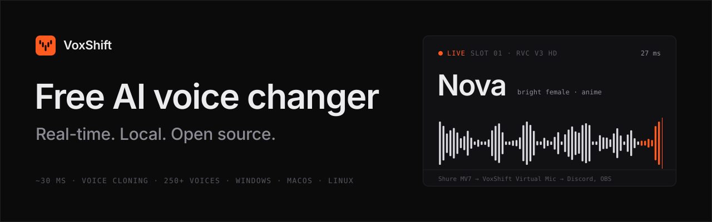
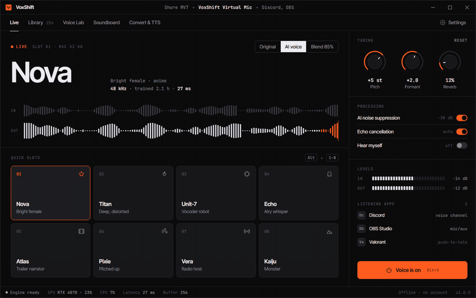
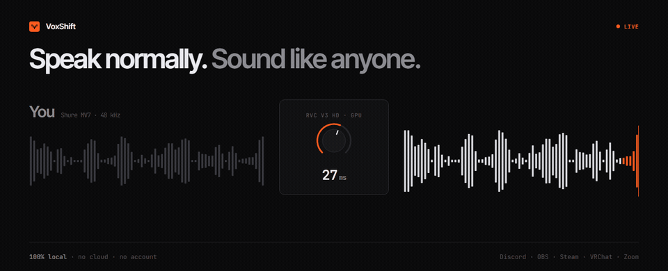
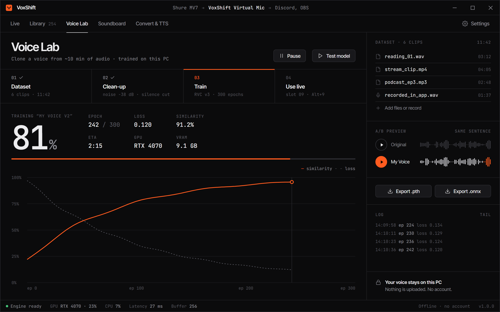
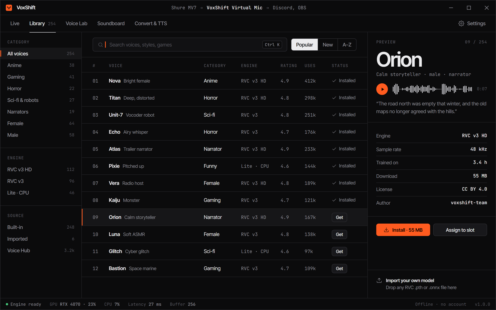
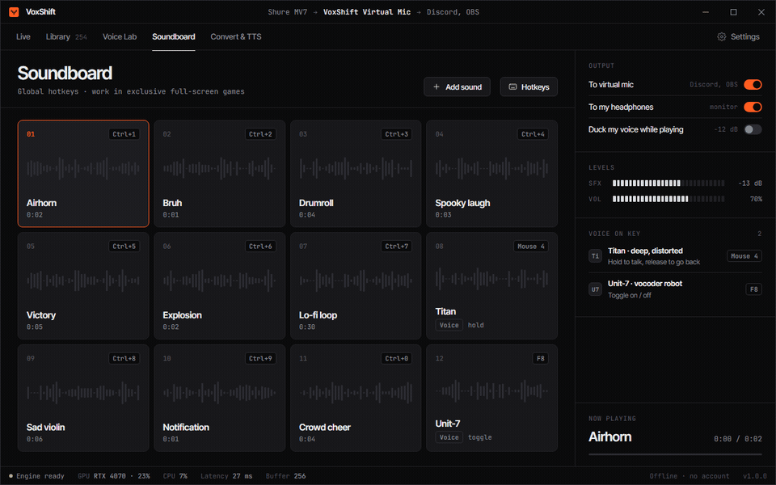
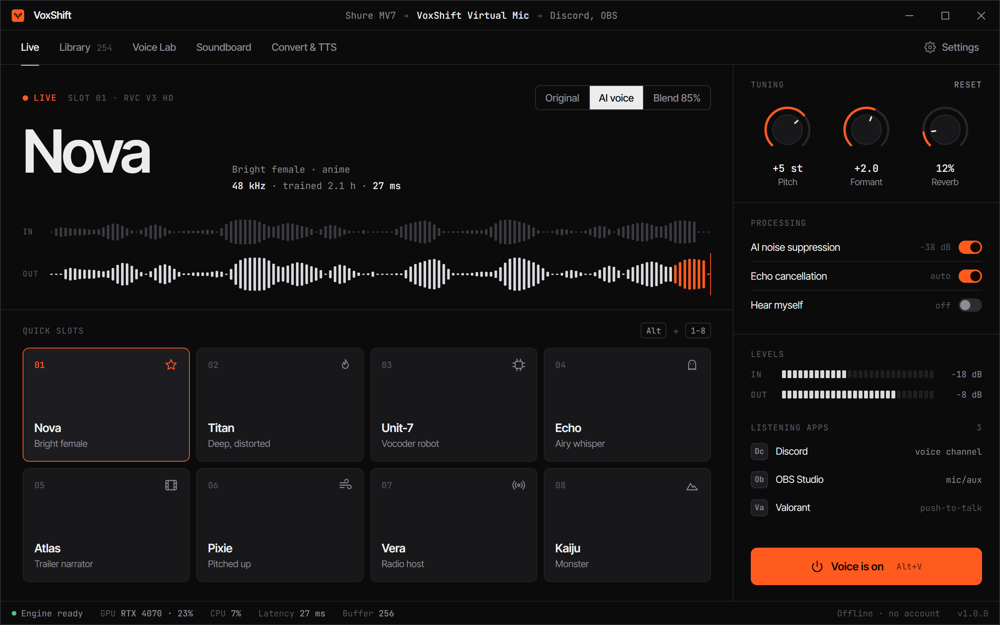
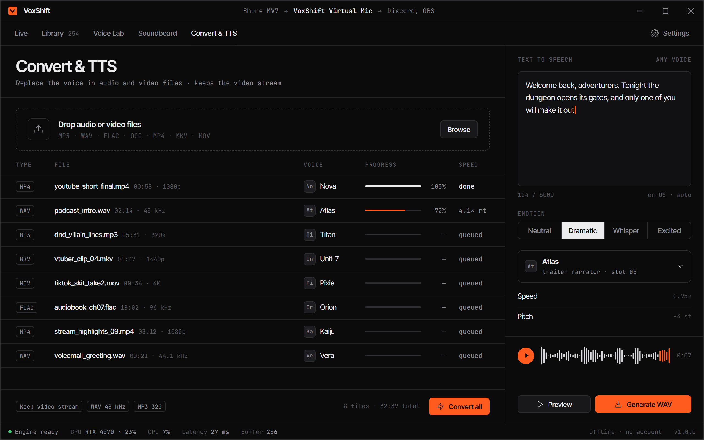
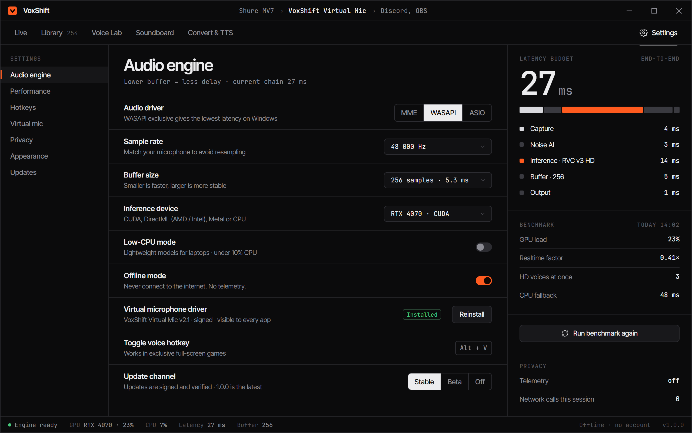
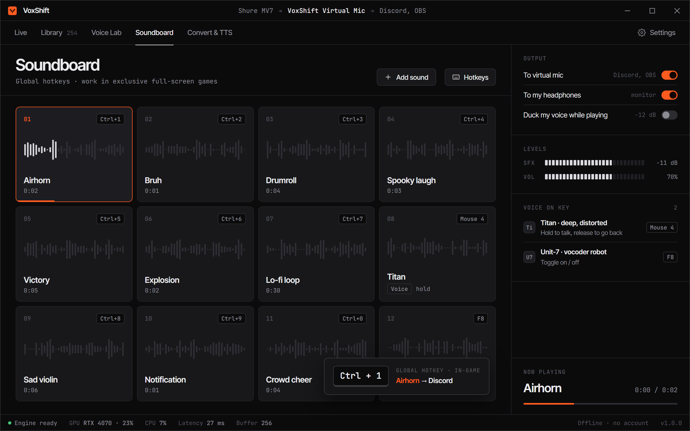

<h1>VoxShift — Windows, macOS और Linux के लिए फ्री AI वॉइस चेंजर</h1>

<b>रियल-टाइम AI वॉइस चेंजर</b>, ~30 ms latency के साथ: <b>लोकल वॉइस क्लोनिंग</b>, 250+ फ्री आवाज़ें, hotkey साउंडबोर्ड और एक वर्चुअल माइक्रोफ़ोन जो <b>Discord, OBS, Twitch, Zoom, Steam और हर गेम</b> में काम करता है। 
100% फ्री · ओपन सोर्स · ऑफ़लाइन चलता है · अकाउंट की ज़रूरत नहीं · कोई ऐड नहीं।

<a href="README.md">English</a> · <a href="README.es.md">Español</a> · <a href="README.ar.md">العربية</a> · <b>हिन्दी</b> · <a href="README.zh-CN.md">简体中文</a> &nbsp;|&nbsp;
<a href="#killer-features">फ़ीचर्स</a> ·
<a href="#download--install">इंस्टॉल</a> ·
<a href="#voxshift-vs-voicemod-clownfish-morphvox-voiceai">तुलना</a> ·
<a href="#faq">FAQ</a>

VoxShift Windows, macOS और Linux के लिए एक फ्री, ओपन-सोर्स AI वॉइस चेंजर है, जो आपकी आवाज़ को रियल-टाइम में (~30 ms) बदलता है और वर्चुअल माइक्रोफ़ोन के ज़रिए उसे Discord, OBS, Twitch, Zoom और गेम्स तक भेजता है।

## एक नज़र में

| | **VoxShift** |
|---|---|
| यह क्या है | लोकल वॉइस क्लोनिंग, साउंडबोर्ड और वर्चुअल माइक्रोफ़ोन वाला रियल-टाइम AI वॉइस चेंजर |
| कीमत | फ्री: कोई पेड प्लान, ऐड, वॉटरमार्क या टाइम लिमिट नहीं |
| लाइसेंस | MIT (ओपन सोर्स) |
| प्लेटफ़ॉर्म | Windows 10 / 11 (x64, ARM64) · macOS 12+ (Apple Silicon और Intel) · Linux (AppImage, `.deb`, Flatpak) |
| ऑफ़लाइन / डेटा | हाँ। कन्वर्ज़न और वॉइस क्लोनिंग आपके PC पर ही चलते हैं; न अकाउंट, न टेलीमेट्री |
| मुख्य फ़ीचर्स | ~30 ms न्यूरल वॉइस कन्वर्ज़न · Voice Lab में ~10 मिनट की ऑडियो से वॉइस क्लोनिंग · 250+ आवाज़ें · इन-गेम hotkeys वाला साउंडबोर्ड · फ़ाइल कन्वर्टर और TTS |
| इनका विकल्प | Voicemod, Clownfish, MorphVOX Pro, Voice.ai |
| वर्ज़न | 1.0.0 |

---

## विषय-सूची

- [VoxShift क्यों?](#why-voxshift)
- [ज़बरदस्त फ़ीचर्स](#killer-features)
- [स्क्रीनशॉट](#screenshots)
- [डाउनलोड और इंस्टॉल](#download--install)
- [क्विक स्टार्ट (60 सेकंड)](#quick-start-60-seconds)
- [VoxShift बनाम Voicemod, Clownfish, MorphVOX, Voice.ai](#voxshift-vs-voicemod-clownfish-morphvox-voiceai)
- [इस्तेमाल के तरीके](#use-cases)
- [अक्सर पूछे जाने वाले सवाल (FAQ)](#faq)
- [रोडमैप](#roadmap)
- [किससे बना है](#built-with)
- [योगदान करें](#contributing)
- [लाइसेंस और ज़िम्मेदार इस्तेमाल](#license--responsible-use)

## VoxShift क्यों?

ज़्यादातर "फ्री" वॉइस चेंजर या तो रोबोटिक pitch shifter होते हैं, या ऐड से भरे होते हैं, या अच्छी आवाज़ों को सब्सक्रिप्शन के पीछे लॉक कर देते हैं। **VoxShift एक न्यूरल वॉइस चेंजर है जो सच में इंसान जैसा सुनाई देता है — और यह फ्री है।**

- **असली आवाज़, रोबोटिक नहीं।** RVC-क्लास न्यूरल मॉडल आपकी आवाज़ को सच में कन्वर्ट करते हैं, सिर्फ़ pitch नहीं बदलते — सांस, इमोशन और लहजा बरकरार रहता है।
- **कॉम्पिटिटिव गेम्स के लिए भी काफ़ी तेज़।** मिड-रेंज GPU पर end-to-end ~30 ms, और सिर्फ़ CPU वाले लैपटॉप पर 60 ms से कम।
- **प्राइवेसी शुरू से ही।** सब कुछ — वॉइस क्लोनिंग भी — लोकल चलता है। न अकाउंट, न टेलीमेट्री, पूरी तरह ऑफ़लाइन काम करता है।
- **फ्री और ओपन सोर्स (MIT)।** न वॉटरमार्क, न टाइम लिमिट, न "प्रीमियम आवाज़ें"। हर फ़ीचर फ्री बिल्ड में ही है।

## ज़बरदस्त फ़ीचर्स

<table>
<tr>
<td width="50%" valign="top">

### रियल-टाइम AI वॉइस कन्वर्ज़न
नॉर्मल तरीके से बोलिए — VoxShift न्यूरल मॉडल से आपकी आवाज़ को रियल-टाइम में दोबारा synthesize करता है। लाइव **latency मीटर** end-to-end देरी दिखाता है (CUDA, DirectML या Apple Metal के साथ आम तौर पर **25–35 ms**), और **A/B blend** से आप अपनी असली आवाज़ को AI आवाज़ के साथ मिला सकते हैं।

</td>
<td width="50%"></td>
</tr>
<tr>
<td width="50%"></td>
<td width="50%" valign="top">

### Voice Lab — अपनी आवाज़ लोकल क्लोन करें
**~10 मिनट की ऑडियो से अपना कस्टम AI वॉइस मॉडल** ट्रेन करें। रिकॉर्डिंग, पॉडकास्ट या स्ट्रीम VOD डालिए — VoxShift डेटासेट साफ़ करता है (noise और silence हटाता है), आपके GPU पर ट्रेन करता है और A/B प्रीव्यू देता है। **आपकी आवाज़ कभी आपके PC से बाहर नहीं जाती।** `.pth` / `.onnx` के रूप में export करें या कम्युनिटी हब पर शेयर करें।

</td>
</tr>
<tr>
<td width="50%" valign="top">

### 250+ फ्री AI आवाज़ें
एनीमे गर्ल, डीप डेमन, रोबोट, भूत, मूवी-ट्रेलर नैरेटर, चिपमंक, रेडियो होस्ट, मॉन्स्टर, स्पेस मरीन, ASMR और भी बहुत कुछ — सब फ्री, सब ऑफ़लाइन। एक क्लिक में ब्राउज़, प्रीव्यू और इंस्टॉल करें, या कोई भी **RVC `.pth` / `.onnx`** मॉडल इम्पोर्ट करें। **Voice Hub** में हज़ारों कम्युनिटी आवाज़ें और मिलती हैं।

</td>
<td width="50%"></td>
</tr>
<tr>
<td width="50%"></td>
<td width="50%" valign="top">

### साउंडबोर्ड + वॉइस hotkeys
गेमर्स के लिए बना साउंडबोर्ड: **ग्लोबल hotkeys फ़ुल-स्क्रीन गेम्स के अंदर भी काम करती हैं**, साउंड आपके माइक *और* हेडफ़ोन दोनों में जाते हैं, और कोई भी key **आवाज़ बदल** सकती है — <kbd>Mouse 4</kbd> दबाकर रखें और डेमन की आवाज़ में बोलें, छोड़ते ही वापस नॉर्मल।

</td>
</tr>
<tr>
<td width="50%" valign="top">

### वर्चुअल माइक्रोफ़ोन — किसी भी ऐप में काम करता है
एक क्लिक में साइन किया हुआ **VoxShift Virtual Mic** ड्राइवर इंस्टॉल हो जाता है। Discord, OBS, Zoom, Teams, Steam, TeamSpeak, VRChat, Valorant, CS2 या Fortnite में इसे इनपुट डिवाइस के रूप में चुनें — Voicemeeter या केबल routing की कोई ज़रूरत नहीं।

### AI से noise और echo हटाएं
न्यूरल noise suppression कन्वर्ज़न से *पहले* ही कीबोर्ड की खटखट, पंखे की आवाज़ और कमरे की गूंज हटा देता है, ताकि AI आवाज़ साफ़ रहे — सस्ते हेडसेट माइक के साथ भी।

</td>
<td width="50%"></td>
</tr>
<tr>
<td width="50%"></td>
<td width="50%" valign="top">

### फ़ाइल में आवाज़ बदलें और text-to-speech
**MP3, WAV, FLAC, MP4, MKV और MOV** फ़ाइलों में एक साथ (batch में) आवाज़ बदलें — वीडियो स्ट्रीम जैसी है वैसी रहती है, सिर्फ़ आवाज़ बदली जाती है। या टेक्स्ट टाइप करें और **किसी भी आवाज़ में TTS** बनाएं, अपनी पसंद के इमोशन के साथ (dramatic, whisper, excited)। YouTube Shorts, TikTok, डबिंग और D&D सेशन के लिए काम का।

</td>
</tr>
<tr>
<td width="50%" valign="top">

### Low-CPU मोड, ऑफ़लाइन, बिना अकाउंट
हल्के मॉडल लैपटॉप और पुराने PC पर CPU इस्तेमाल **10% से कम** रखते हैं। ऑफ़लाइन मोड हर नेटवर्क कॉल को ब्लॉक कर देता है। न साइन-अप, न ऐड, न टेलीमेट्री — कभी नहीं।

</td>
<td width="50%"></td>
</tr>
</table>

## स्क्रीनशॉट

<table>
<tr>
<td></td>
<td></td>
<td></td>
</tr>
<tr>
<td align="center"><b>लाइव वॉइस</b> — रियल-टाइम कन्वर्ज़न</td>
<td align="center"><b>वॉइस लाइब्रेरी</b> — 250+ आवाज़ें</td>
<td align="center"><b>Voice Lab</b> — अपनी आवाज़ क्लोन करें</td>
</tr>
<tr>
<td></td>
<td></td>
<td></td>
</tr>
<tr>
<td align="center"><b>साउंडबोर्ड</b> — ग्लोबल hotkeys</td>
<td align="center"><b>कन्वर्टर और TTS</b></td>
<td align="center"><b>सेटिंग्स</b> — WASAPI / ASIO</td>
</tr>
</table>

## डाउनलोड और इंस्टॉल

| OS | पैकेज | कमांड / लिंक |
|---|---|---|
| **Windows 10 / 11** (x64, ARM64) | इंस्टॉलर `.exe` · पोर्टेबल `.zip` | [VoxShift-Setup-1.0.0-x64.exe](https://github.com/ShardHazeGap/voxshift/releases/latest) |
| | winget | `winget install VoxShift.VoxShift` |
| | Scoop | `scoop bucket add extras && scoop install voxshift` |
| **macOS 12+** (Apple Silicon और Intel) | Universal `.dmg` | [VoxShift-1.0.0-universal.dmg](https://github.com/ShardHazeGap/voxshift/releases/latest) |
| | Homebrew | `brew install --cask voxshift` |
| **Linux** (x86_64) | AppImage · `.deb` · Flatpak | [VoxShift-1.0.0-x86_64.AppImage](https://github.com/ShardHazeGap/voxshift/releases/latest) · `flatpak install flathub app.voxshift.VoxShift` |

**सिस्टम रिक्वायरमेंट्स**

| | मिनिमम (Low-CPU मोड) | रिकमेंडेड (HD आवाज़ें, ~30 ms) |
|---|---|---|
| CPU | 4 कोर, 2015 या उसके बाद का | 6+ कोर |
| GPU | ज़रूरी नहीं | NVIDIA GTX 1660 / RTX 20xx+, AMD RX 6000+ (DirectML), Apple M1+ |
| RAM | 4 GB | 8 GB+ |
| Voice Lab ट्रेनिंग | — | 6 GB+ VRAM (NVIDIA) या Apple M-series |

> हर रिलीज़ साइन की हुई होती है और SHA-256 checksums के साथ आती है। सिर्फ़ [GitHub Releases](https://github.com/ShardHazeGap/voxshift/releases) से ही डाउनलोड करें।

## क्विक स्टार्ट (60 सेकंड)

1. **VoxShift इंस्टॉल करें और खोलें** — सेटअप विज़ार्ड वर्चुअल माइक ड्राइवर इंस्टॉल करता है और आपके GPU का बेंचमार्क करता है।
2. *Live Voice* में **एक आवाज़ चुनें** (या <kbd>Alt</kbd> + <kbd>1</kbd>…<kbd>8</kbd> दबाएं) और **Voice ON** दबाएं।
3. **Discord / OBS / अपने गेम में** इनपुट डिवाइस को **`VoxShift Virtual Mic`** पर सेट करें। हो गया।

<b>Discord सेटअप स्टेप-बाय-स्टेप</b>

1. Discord में *User Settings* → *Voice & Video* खोलें।
2. **Input Device** में `VoxShift Virtual Mic` चुनें।
3. Discord का *Noise Suppression* और *Echo Cancellation* **बंद** करें (VoxShift का AI यह काम पहले से बेहतर करता है)।
4. *Input Sensitivity* को automatic पर रखें। अब बोलिए — आपके दोस्तों को AI आवाज़ सुनाई देगी।

<b>OBS / Streamlabs सेटअप</b>

*Sources* → *Audio Input Capture* → डिवाइस `VoxShift Virtual Mic` चुनें। आवाज़ डबल न हो, इसके लिए अपने असली माइक वाले सोर्स को म्यूट कर दें।

## VoxShift बनाम Voicemod, Clownfish, MorphVOX, Voice.ai

| | **VoxShift** | Voicemod | Clownfish | MorphVOX Pro | Voice.ai |
|---|:---:|:---:|:---:|:---:|:---:|
| कीमत | **फ्री (MIT)** | Freemium / सब्सक्रिप्शन | फ्री | पेड | Freemium |
| न्यूरल AI आवाज़ें (सिर्फ़ pitch-shift नहीं) | ✓ | Pro | — | — | ✓ |
| अपनी आवाज़ **लोकल** क्लोन करें | ✓ | — | — | — | क्लाउड |
| ऑफ़लाइन, बिना अकाउंट | ✓ | — | ✓ | ✓ | — |
| ओपन सोर्स | ✓ | — | — | — | — |
| बिल्ट-इन साउंडबोर्ड + वॉइस hotkeys | ✓ | ✓ | — | आंशिक | — |
| ऑडियो/वीडियो फ़ाइलों में आवाज़ बदलना | ✓ | — | — | आंशिक | आंशिक |
| किसी भी आवाज़ में text-to-speech | ✓ | आंशिक | ✓ | — | — |
| RVC `.pth` / `.onnx` मॉडल इम्पोर्ट | ✓ | — | — | — | आंशिक |
| macOS और Linux | ✓ | macOS | — | — | — |
| ऐड / अपसेल | **कोई नहीं** | हाँ | नहीं | हाँ | हाँ |

**फ्री Voicemod alternative ढूंढ रहे हैं?** VoxShift, Voicemod, Clownfish, MorphVOX Pro और Voice.ai का फ्री, ओपन-सोर्स विकल्प है — और बिल्ट-इन वर्चुअल माइक की वजह से आपको Voicemeeter की भी ज़रूरत नहीं पड़ती।

तुलना v1.0.0 के समय सार्वजनिक रूप से उपलब्ध जानकारी पर आधारित है। ट्रेडमार्क अपने-अपने मालिकों के हैं। कोई गलती मिली? [Issue खोलें](https://github.com/ShardHazeGap/voxshift/issues)।

## इस्तेमाल के तरीके

### Discord के लिए वॉइस चेंजर
VoxShift को अपना Discord इनपुट डिवाइस बनाएं और कॉल के बीच में hotkeys से आवाज़ बदलें। वॉइस चैनल, Stage और DMs में काम करता है, और Discord का अपना साउंडबोर्ड भी VoxShift के साउंडबोर्ड के साथ-साथ चलता है।

### स्ट्रीमिंग के लिए वॉइस चेंजर (OBS, Twitch, YouTube, Kick)
चेहरा दिखाए बिना किसी कैरेक्टर के रूप में स्ट्रीम करें — **faceless स्ट्रीमर्स और VTubers** के लिए एकदम सही। आवाज़ें और साउंड Stream Deck या hotkeys पर सेट करें और वर्चुअल माइक को OBS में route करें।

### गेम्स के लिए वॉइस चेंजर (Valorant, CS2, Fortnite, Apex, GTA RP)
ग्लोबल hotkeys exclusive full-screen में भी काम करती हैं। कम latency का मतलब है कि आपके callouts समय पर पहुंचते हैं। उस clutch मोमेंट के लिए एक key दबाकर रखें और डेमन की आवाज़ पर स्विच करें। GTA V RP खिलाड़ी अपने कैरेक्टर की आवाज़ एक जैसी बनाए रखने के लिए VoxShift इस्तेमाल करते हैं।

### VRChat और VTubers के लिए वॉइस चेंजर
अपने अवतार के साथ प्यारी एनीमे आवाज़ या गहरी मॉन्स्टर आवाज़ जोड़ें। Voice Lab में अपने कैरेक्टर की आवाज़ क्लोन करें और VRChat, Twitch और TikTok पर एक जैसी आवाज़ इस्तेमाल करें।

### कंटेंट क्रिएटर्स, पॉडकास्टर्स और डबिंग के लिए
वॉइसओवर एक साथ कन्वर्ट करें, इंटरव्यू गेस्ट्स की पहचान छिपाएं, एनिमेशन, YouTube Shorts और TikTok के लिए कैरेक्टर आवाज़ें बनाएं, या text-to-speech से नैरेशन तैयार करें।

## अक्सर पूछे जाने वाले सवाल (FAQ)

<b>क्या VoxShift सच में फ्री है?</b>

हाँ। VoxShift MIT लाइसेंस के तहत फ्री और ओपन सोर्स है। कोई पेड प्लान, ऐड, वॉटरमार्क या टाइम लिमिट नहीं है। आप GitHub Sponsors के ज़रिए डेवलपमेंट को सपोर्ट कर सकते हैं।

<b>Discord पर फ्री में आवाज़ कैसे बदलें?</b>

VoxShift इंस्टॉल करें, एक आवाज़ चुनें, **Voice ON** पर क्लिक करें, फिर Discord → Voice & Video में इनपुट डिवाइस को **VoxShift Virtual Mic** पर सेट करें। देखें [Discord सेटअप](#quick-start-60-seconds)।

<b>क्या यह रियल-टाइम वॉइस चेंजर है? Latency कितनी है?</b>

हाँ। NVIDIA RTX / AMD RX 6000 / Apple M1 GPU पर आम तौर पर end-to-end latency 25–35 ms होती है, और Low-CPU मोड में 45–60 ms। ऐप का latency मीटर आपका सटीक नंबर दिखाता है।

<b>क्या मैं अपनी आवाज़ क्लोन कर सकता हूँ? क्या यह सुरक्षित है?</b>

हाँ — Voice Lab आपकी लगभग 10 मिनट की ऑडियो से मॉडल ट्रेन करता है। ट्रेनिंग और inference पूरी तरह आपके PC पर चलते हैं; कुछ भी अपलोड नहीं होता। सिर्फ़ वही आवाज़ें क्लोन करें जो आपकी अपनी हैं या जिन्हें इस्तेमाल करने की आपके पास साफ़ अनुमति है।

<b>क्या VoxShift बिना GPU के चलता है?</b>

हाँ। Low-CPU मोड हल्के मॉडल इस्तेमाल करता है, जो किसी भी मॉडर्न 4-कोर CPU पर 10% से कम इस्तेमाल में चलते हैं। GPU होने पर HD आवाज़ें और कम latency मिलती है।

<b>क्या वॉइस चेंजर इस्तेमाल करने से Valorant, CS2 या Fortnite में बैन हो जाऊंगा?</b>

नहीं। VoxShift गेम प्रोसेस को छूता ही नहीं है — यह एक स्टैंडर्ड ऑडियो इनपुट डिवाइस है, बिल्कुल USB माइक्रोफ़ोन की तरह। यह anti-cheat का मामला नहीं है।

<b>क्या मैं इंटरनेट से लिए गए RVC मॉडल इस्तेमाल कर सकता हूँ?</b>

हाँ। *Voice Library → Import* से कोई भी RVC v1/v2 `.pth` या `.onnx` मॉडल इम्पोर्ट करें। हर मॉडल के लाइसेंस का सम्मान करें।

<b>क्या यह macOS और Linux पर चलता है?</b>

हाँ। macOS 12+ (Apple Silicon पर Metal एक्सेलेरेशन) और Linux पर AppImage, `.deb` या Flatpak के ज़रिए (PipeWire / PulseAudio वर्चुअल सोर्स)।

<b>क्या VoxShift, Voicemod का विकल्प है?</b>

हाँ — VoxShift, Voicemod के मुख्य फ़ीचर्स (रियल-टाइम आवाज़ें, साउंडबोर्ड, hotkeys, वर्चुअल माइक) देता है और साथ में लोकल वॉइस क्लोनिंग, फ़ाइल कन्वर्ज़न और TTS भी जोड़ता है — फ्री में और बिना अकाउंट के।

<b>वीडियो फ़ाइल में आवाज़ कैसे बदलें?</b>

*Converter & TTS* खोलें, कोई MP4/MKV/MOV फ़ाइल डालें, आवाज़ चुनें और **Convert all** पर क्लिक करें। VoxShift ओरिजिनल वीडियो वैसा ही रखता है और सिर्फ़ वॉइस ट्रैक बदलता है।

## रोडमैप

- [x] रियल-टाइम RVC v3 इंजन (CUDA, DirectML, Metal, CPU)
- [x] Voice Lab — लोकल वॉइस क्लोनिंग
- [x] ग्लोबल hotkeys और हर key पर अलग आवाज़ वाला साउंडबोर्ड
- [x] फ़ाइल कन्वर्टर + text-to-speech
- [ ] Stream Deck और Touch Portal प्लगइन
- [ ] रियल-टाइम सिंगिंग मोड (सटीक pitch के साथ)
- [ ] Android कंपेनियन ऐप (रिमोट साउंडबोर्ड)
- [ ] सिर्फ़ 10 सेकंड की ऑडियो से zero-shot वॉइस क्लोनिंग
- [ ] ट्रांसलेशन मोड — अंग्रेज़ी बोलें, सुनाई दे जैसे आप जापानी बोल रहे हों

फ़ीचर्स पर [Discussions](https://github.com/ShardHazeGap/voxshift/discussions) में वोट करें।

## किससे बना है

UI डिज़ाइन का सोर्स [`design/`](design/DESIGN.md) में है — इस README का हर स्क्रीनशॉट और GIF उसी से रेंडर किया गया है।

## योगदान करें

PRs, नई आवाज़ों और ट्रांसलेशन का स्वागत है। [CONTRIBUTING.md](CONTRIBUTING.md) पढ़ें, कोई [`good first issue`](https://github.com/ShardHazeGap/voxshift/labels/good%20first%20issue) चुनें और [Discord](https://github.com/DISCORD_INVITE) पर हमसे जुड़ें।

### स्टार हिस्ट्री

## लाइसेंस और ज़िम्मेदार इस्तेमाल

VoxShift [MIT License](LICENSE) के तहत जारी किया गया है।

वॉइस चेंजिंग और वॉइस क्लोनिंग ताक़तवर टूल हैं। VoxShift का इस्तेमाल असली लोगों की बिना सहमति के नकल करने, धोखाधड़ी करने, दूसरों को परेशान करने या आवाज़-आधारित authentication को बायपास करने के लिए **न करें**। सिर्फ़ वही आवाज़ें क्लोन करें जो आपकी अपनी हैं या जिन्हें इस्तेमाल करने की आपके पास साफ़ अनुमति है। अपने देश के कानूनों का पालन करना आपकी ज़िम्मेदारी है।

---

**अगर VoxShift आपके काम का है, तो रिपो को स्टार दें। इससे दूसरे लोगों को एक फ्री वॉइस चेंजर ढूंढने में मदद मिलती है।**

कीवर्ड्स: फ्री वॉइस चेंजर · AI वॉइस चेंजर · रियल-टाइम वॉइस चेंजर · Discord के लिए वॉइस चेंजर · PC के लिए वॉइस चेंजर · आवाज़ बदलने वाला ऐप · आवाज़ कैसे बदलें · RVC वॉइस चेंजर · वॉइस क्लोनिंग · एनीमे वॉइस चेंजर · साउंडबोर्ड · Voicemod alternative · free voice changer · Windows, macOS और Linux के लिए ओपन-सोर्स वॉइस चेंजर

