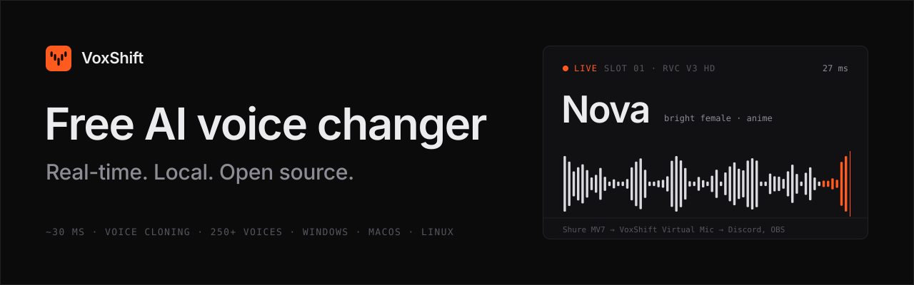
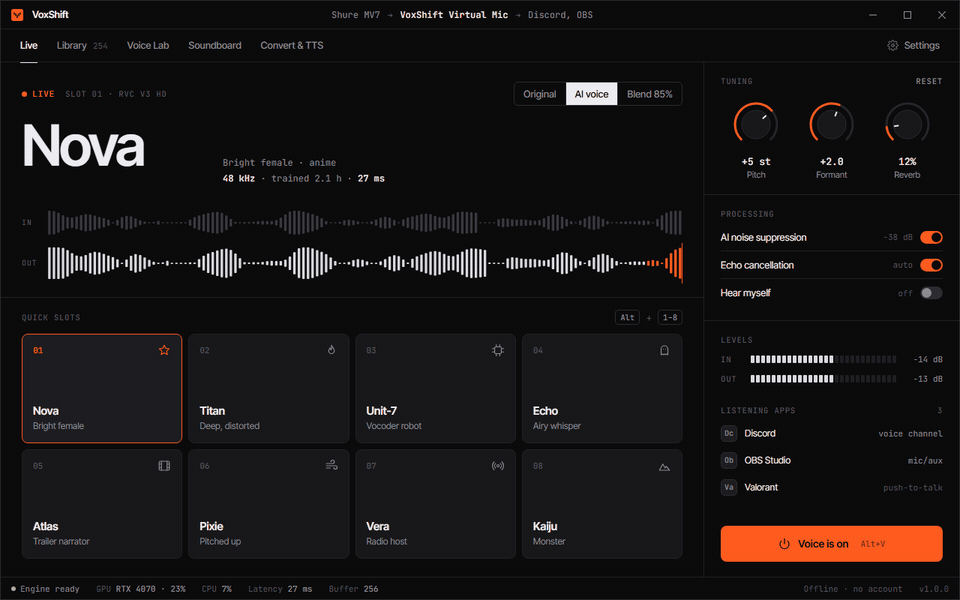
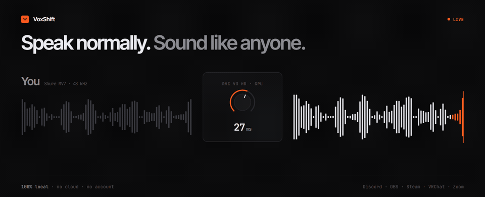
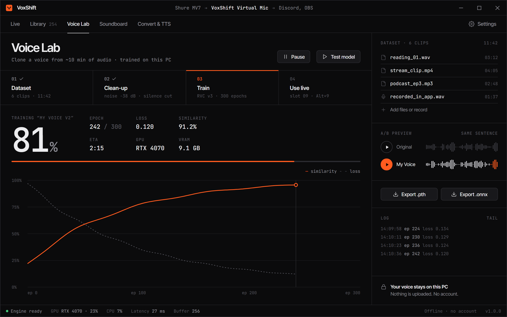
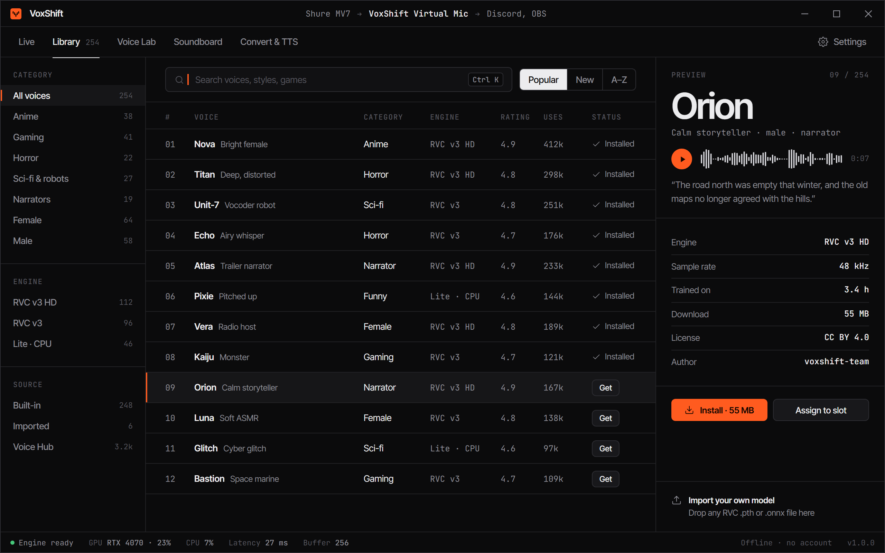
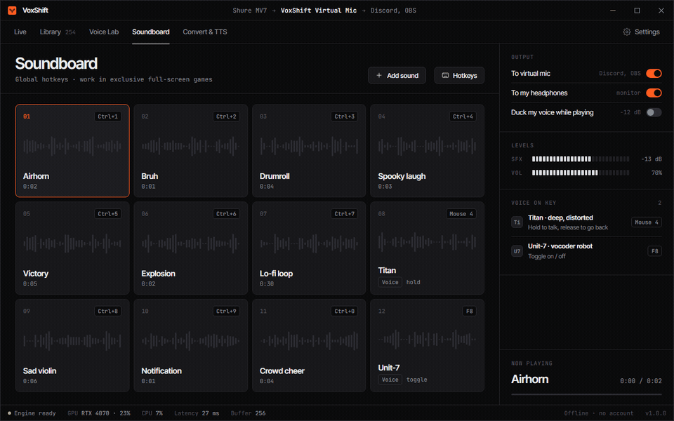
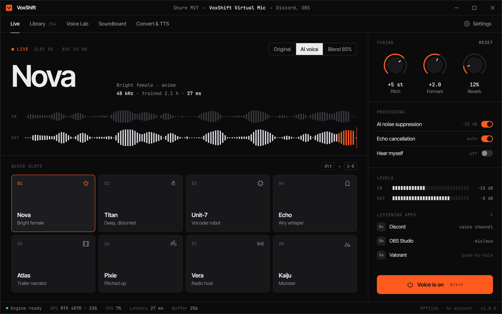
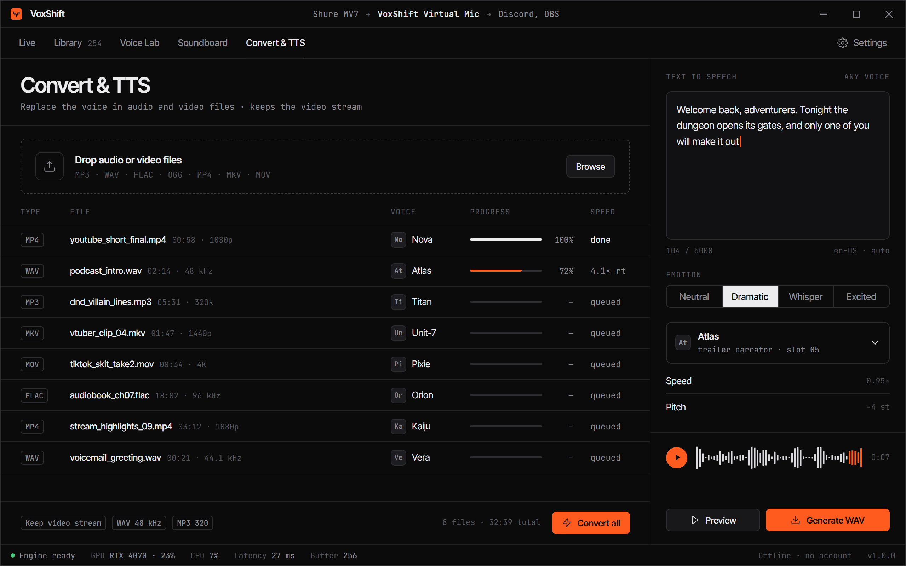
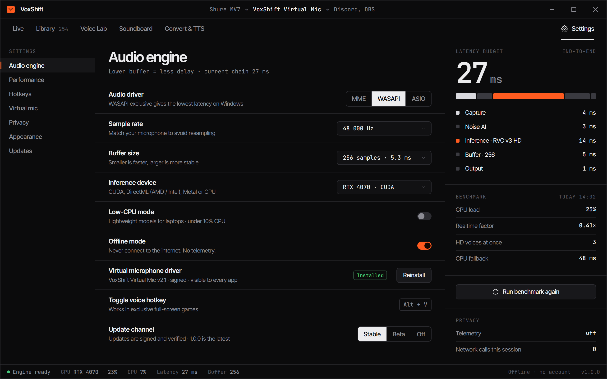
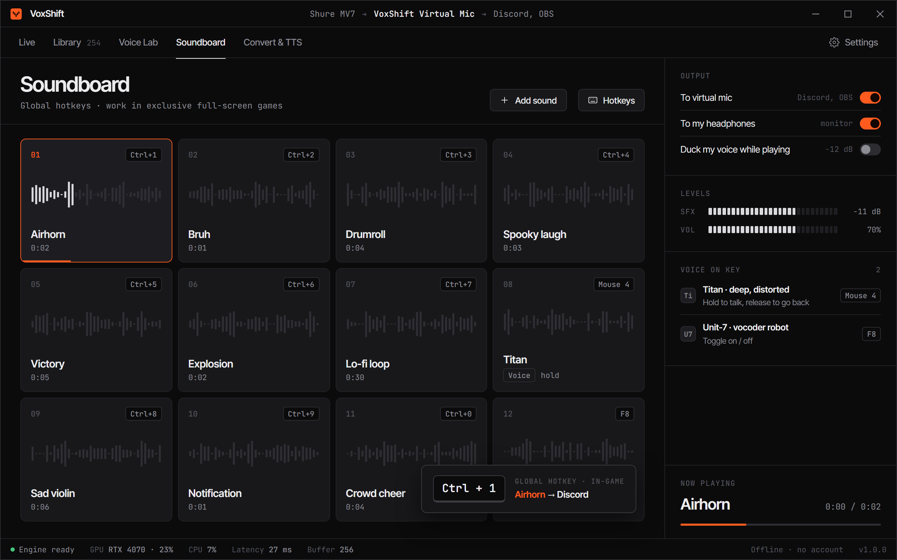

<h1>VoxShift — Free AI Voice Changer for Windows, macOS &amp; Linux</h1>

<b>Real-time AI voice changer</b> with ~30 ms latency, <b>local voice cloning</b>, 250+ free voices, a hotkey soundboard and a virtual microphone that works in <b>Discord, OBS, Twitch, Zoom, Steam and every game</b>. 
100% free · open source · runs offline · no account · no ads.

<b>English</b> · <a href="README.es.md">Español</a> · <a href="README.ar.md">العربية</a> · <a href="README.hi.md">हिन्दी</a> · <a href="README.zh-CN.md">简体中文</a> &nbsp;|&nbsp;
<a href="#killer-features">Features</a> ·
<a href="#download--install">Install</a> ·
<a href="#voxshift-vs-voicemod-clownfish-morphvox-voiceai">Comparison</a> ·
<a href="#faq">FAQ</a>

VoxShift is a free, open-source AI voice changer for Windows, macOS and Linux that changes your voice in real time (~30 ms) and sends it to Discord, OBS, Twitch, Zoom and games through a virtual microphone.

## At a glance

| | **VoxShift** |
|---|---|
| What it is | Real-time AI voice changer with local voice cloning, soundboard and virtual microphone |
| Price | Free: no paid tiers, ads, watermarks or time limits |
| License | MIT (open source) |
| Platforms | Windows 10 / 11 (x64, ARM64) · macOS 12+ (Apple Silicon & Intel) · Linux (AppImage, `.deb`, Flatpak) |
| Works offline / data | Yes. Conversion and voice cloning run on your PC; no account, no telemetry |
| Main features | ~30 ms neural voice conversion · Voice Lab cloning from ~10 min of audio · 250+ voices · soundboard with in-game hotkeys · file converter & TTS |
| Alternative to | Voicemod, Clownfish, MorphVOX Pro, Voice.ai |
| Version | 1.0.0 |

---

## Table of contents

- [Why VoxShift?](#why-voxshift)
- [Killer features](#killer-features)
- [Screenshots](#screenshots)
- [Download & install](#download--install)
- [Quick start (60 seconds)](#quick-start-60-seconds)
- [VoxShift vs Voicemod, Clownfish, MorphVOX, Voice.ai](#voxshift-vs-voicemod-clownfish-morphvox-voiceai)
- [Use cases](#use-cases)
- [FAQ](#faq)
- [Roadmap](#roadmap)
- [Built with](#built-with)
- [Contributing](#contributing)
- [License & responsible use](#license--responsible-use)

## Why VoxShift?

Most "free" voice changers are robotic pitch shifters, ad-supported, or lock the good voices behind a subscription. **VoxShift is a neural voice changer that actually sounds human — and it is free.**

- **Sounds real, not robotic.** RVC-class neural models convert your voice, not just pitch-shift it — breaths, emotion and accent are preserved.
- **Fast enough for competitive games.** ~30 ms end-to-end on a mid-range GPU, under 60 ms on CPU-only laptops.
- **Private by design.** Everything — including voice cloning — runs locally. No account, no telemetry, works fully offline.
- **Free and open source (MIT).** No watermarks, no time limits, no "premium voices". Every feature is in the free build.

## Killer features

<table>
<tr>
<td width="50%" valign="top">

### Real-time AI voice conversion
Speak normally — VoxShift re-synthesizes your voice with a neural model in real time. A live **latency meter** shows end-to-end delay (typically **25–35 ms** with CUDA, DirectML or Apple Metal), and the **A/B blend** lets you mix your original voice with the AI voice.

</td>
<td width="50%"></td>
</tr>
<tr>
<td width="50%"></td>
<td width="50%" valign="top">

### Voice Lab — clone your own voice locally
Train a custom **AI voice model from ~10 minutes of audio**. Drop in recordings, podcasts or stream VODs — VoxShift cleans the dataset (noise & silence removal), trains on your GPU and gives you an A/B preview. **Your voice never leaves your PC.** Export as `.pth` / `.onnx` or share to the community hub.

</td>
</tr>
<tr>
<td width="50%" valign="top">

### 250+ free AI voices
Anime girl, deep demon, robot, ghost, movie-trailer narrator, chipmunk, radio host, monster, space marine, ASMR and more — all free, all offline. Browse, preview and install in one click, or import any **RVC `.pth` / `.onnx`** model. The **Voice Hub** adds thousands of community voices.

</td>
<td width="50%"></td>
</tr>
<tr>
<td width="50%"></td>
<td width="50%" valign="top">

### Soundboard + voice hotkeys
A soundboard built for gamers: **global hotkeys work inside full-screen games**, sounds go to your mic *and* your headphones, and any key can **switch voices** — hold <kbd>Mouse 4</kbd> to talk as a demon, release to go back.

</td>
</tr>
<tr>
<td width="50%" valign="top">

### Virtual microphone — works in any app
One click installs the signed **VoxShift Virtual Mic** driver. Pick it as the input device in Discord, OBS, Zoom, Teams, Steam, TeamSpeak, VRChat, Valorant, CS2 or Fortnite — no Voicemeeter or cable routing needed.

### AI noise & echo suppression
Neural noise suppression removes keyboard clicks, fans and room echo *before* conversion, so the AI voice stays clean — even with a cheap headset mic.

</td>
<td width="50%"></td>
</tr>
<tr>
<td width="50%"></td>
<td width="50%" valign="top">

### Voice-to-file converter & text-to-speech
Batch-change the voice in **MP3, WAV, FLAC, MP4, MKV and MOV** files — the video stream is kept intact, only the voice is replaced. Or type text and generate **TTS with any voice** and emotion (dramatic, whisper, excited). Useful for YouTube Shorts, TikTok, dubbing and D&D sessions.

</td>
</tr>
<tr>
<td width="50%" valign="top">

### Low-CPU mode, offline, no account
Lightweight models keep CPU usage **under 10%** on laptops and older PCs. Offline mode blocks every network call. No sign-up, no ads, no telemetry — ever.

</td>
<td width="50%"></td>
</tr>
</table>

## Screenshots

<table>
<tr>
<td></td>
<td></td>
<td></td>
</tr>
<tr>
<td align="center"><b>Live Voice</b> — real-time conversion</td>
<td align="center"><b>Voice Library</b> — 250+ voices</td>
<td align="center"><b>Voice Lab</b> — clone your voice</td>
</tr>
<tr>
<td></td>
<td></td>
<td></td>
</tr>
<tr>
<td align="center"><b>Soundboard</b> — global hotkeys</td>
<td align="center"><b>Converter &amp; TTS</b></td>
<td align="center"><b>Settings</b> — WASAPI / ASIO</td>
</tr>
</table>

## Download & install

| OS | Package | Command / link |
|---|---|---|
| **Windows 10 / 11** (x64, ARM64) | Installer `.exe` · Portable `.zip` | [VoxShift-Setup-1.0.0-x64.exe](https://github.com/ShardHazeGap/voxshift/releases/latest) |
| | winget | `winget install VoxShift.VoxShift` |
| | Scoop | `scoop bucket add extras && scoop install voxshift` |
| **macOS 12+** (Apple Silicon & Intel) | Universal `.dmg` | [VoxShift-1.0.0-universal.dmg](https://github.com/ShardHazeGap/voxshift/releases/latest) |
| | Homebrew | `brew install --cask voxshift` |
| **Linux** (x86_64) | AppImage · `.deb` · Flatpak | [VoxShift-1.0.0-x86_64.AppImage](https://github.com/ShardHazeGap/voxshift/releases/latest) · `flatpak install flathub app.voxshift.VoxShift` |

**System requirements**

| | Minimum (Low-CPU mode) | Recommended (HD voices, ~30 ms) |
|---|---|---|
| CPU | 4 cores, 2015+ | 6+ cores |
| GPU | not required | NVIDIA GTX 1660 / RTX 20xx+, AMD RX 6000+ (DirectML), Apple M1+ |
| RAM | 4 GB | 8 GB+ |
| Voice Lab training | — | 6 GB+ VRAM (NVIDIA) or Apple M-series |

> Every release is signed and ships with SHA-256 checksums. Download only from [GitHub Releases](https://github.com/ShardHazeGap/voxshift/releases).

## Quick start (60 seconds)

1. **Install & launch VoxShift** — the setup wizard installs the virtual mic driver and benchmarks your GPU.
2. **Pick a voice** in *Live Voice* (or press <kbd>Alt</kbd> + <kbd>1</kbd>…<kbd>8</kbd>) and hit **Voice ON**.
3. **In Discord / OBS / your game** set the input device to **`VoxShift Virtual Mic`**. Done.

<b>Discord setup step-by-step</b>

1. Discord → *User Settings* → *Voice & Video*.
2. **Input Device** → `VoxShift Virtual Mic`.
3. Turn **off** Discord's *Noise Suppression* and *Echo Cancellation* (VoxShift's AI already does this better).
4. Set *Input Sensitivity* to automatic. Talk — your friends hear the AI voice.

<b>OBS / Streamlabs setup</b>

*Sources* → *Audio Input Capture* → device `VoxShift Virtual Mic`. Mute your raw mic source to avoid doubling.

## VoxShift vs Voicemod, Clownfish, MorphVOX, Voice.ai

| | **VoxShift** | Voicemod | Clownfish | MorphVOX Pro | Voice.ai |
|---|:---:|:---:|:---:|:---:|:---:|
| Price | **Free (MIT)** | Freemium / subscription | Free | Paid | Freemium |
| Neural AI voices (not pitch-shift) | ✓ | Pro | — | — | ✓ |
| Clone your own voice **locally** | ✓ | — | — | — | cloud |
| Works offline, no account | ✓ | — | ✓ | ✓ | — |
| Open source | ✓ | — | — | — | — |
| Built-in soundboard + voice hotkeys | ✓ | ✓ | — | partial | — |
| Voice-change audio/video files | ✓ | — | — | partial | partial |
| Text-to-speech with any voice | ✓ | partial | ✓ | — | — |
| Import RVC `.pth` / `.onnx` models | ✓ | — | — | — | partial |
| macOS & Linux | ✓ | macOS | — | — | — |
| Ads / upsells | **None** | Yes | No | Yes | Yes |

**Looking for a free Voicemod alternative?** VoxShift is a free, open-source alternative to Voicemod, Clownfish, MorphVOX Pro and Voice.ai — and with the built-in virtual mic you don't need Voicemeeter either.

Comparison based on publicly available information as of v1.0.0. Trademarks belong to their respective owners. Found a mistake? [Open an issue](https://github.com/ShardHazeGap/voxshift/issues).

## Use cases

### Voice changer for Discord
Use VoxShift as your Discord input device and switch voices mid-call with hotkeys. Works in voice channels, Stage, DMs and Discord's soundboard alongside VoxShift's own.

### Voice changer for streaming (OBS, Twitch, YouTube, Kick)
Stream as a character without showing your face — perfect for **faceless streamers and VTubers**. Bind voices and sounds to Stream Deck or hotkeys and route the virtual mic into OBS.

### Voice changer for games (Valorant, CS2, Fortnite, Apex, GTA RP)
Global hotkeys work in exclusive full-screen. Low latency means your callouts stay on time. Hold a key to switch to a demon voice for that clutch moment. GTA V RP players use VoxShift to keep a consistent character voice.

### Voice changer for VRChat and VTubers
Pair a cute anime voice or deep monster voice with your avatar. Clone your character's voice in Voice Lab and use it consistently across VRChat, Twitch and TikTok.

### For content creators, podcasters & dubbing
Batch-convert voiceovers, anonymize interview guests, create character voices for animations, YouTube Shorts and TikTok, or generate narration with text-to-speech.

## FAQ

<b>Is VoxShift really free?</b>

Yes. VoxShift is free and open source under the MIT license. There are no paid tiers, ads, watermarks or time limits. You can support development via GitHub Sponsors.

<b>How do I change my voice on Discord for free?</b>

Install VoxShift, pick a voice, click **Voice ON**, then in Discord → Voice & Video set the input device to **VoxShift Virtual Mic**. See [Discord setup](#quick-start-60-seconds).

<b>Is it a real-time voice changer? How much latency is there?</b>

Yes. Typical end-to-end latency is 25–35 ms on an NVIDIA RTX / AMD RX 6000 / Apple M1 GPU and 45–60 ms in Low-CPU mode. The latency meter in the app shows your exact number.

<b>Can I clone my own voice? Is it safe?</b>

Yes — Voice Lab trains a model from about 10 minutes of your audio. Training and inference run entirely on your PC; nothing is uploaded. Only clone voices you own or have explicit permission to use.

<b>Does VoxShift work without a GPU?</b>

Yes. Low-CPU mode uses lightweight models that run on any modern 4-core CPU with under 10% usage. A GPU unlocks HD voices and lower latency.

<b>Will a voice changer get me banned in Valorant, CS2 or Fortnite?</b>

No. VoxShift doesn't touch the game process — it's a standard audio input device, just like a USB microphone. It's not an anti-cheat concern.

<b>Can I use RVC models from the internet?</b>

Yes. Import any RVC v1/v2 `.pth` or `.onnx` model via *Voice Library → Import*. Respect the licence of each model.

<b>Does it work on macOS and Linux?</b>

Yes. macOS 12+ (Apple Silicon uses Metal acceleration) and Linux via AppImage, `.deb` or Flatpak (PipeWire / PulseAudio virtual source).

<b>Is VoxShift a Voicemod alternative?</b>

Yes — VoxShift covers Voicemod's core features (real-time voices, soundboard, hotkeys, virtual mic) and adds local voice cloning, file conversion and TTS, for free and without an account.

<b>How do I change the voice in a video file?</b>

Open *Converter & TTS*, drop an MP4/MKV/MOV, pick a voice and click **Convert all**. VoxShift keeps the original video and replaces only the voice track.

## Roadmap

- [x] Real-time RVC v3 engine (CUDA, DirectML, Metal, CPU)
- [x] Voice Lab — local voice cloning
- [x] Soundboard with global hotkeys and per-key voice switching
- [x] File converter + text-to-speech
- [ ] Stream Deck & Touch Portal plugin
- [ ] Real-time singing mode (pitch-accurate)
- [ ] Android companion app (remote soundboard)
- [ ] Zero-shot voice cloning from 10 seconds of audio
- [ ] Translation mode — speak English, sound like you're speaking Japanese

Vote on features in [Discussions](https://github.com/ShardHazeGap/voxshift/discussions).

## Built with

UI design source lives in `design/` — every screenshot and GIF in this README is rendered from it.

## Contributing

PRs, new voices and translations are welcome. Read [CONTRIBUTING.md](CONTRIBUTING.md), pick a [`good first issue`](https://github.com/ShardHazeGap/voxshift/labels/good%20first%20issue) and join us on [Discord](https://github.com/DISCORD_INVITE).

### Star history

## License & responsible use

VoxShift is released under the [MIT License](LICENSE).

Voice changing and voice cloning are powerful tools. **Do not** use VoxShift to impersonate real people without consent, commit fraud, harass others or bypass voice-based authentication. Clone only voices you own or have explicit permission to use. You are responsible for complying with the laws of your country.

---

**If VoxShift is useful to you, star the repo. It helps other people find a free voice changer.**

Keywords: free voice changer · AI voice changer · real-time voice changer · voice changer for Discord · voice changer for PC · RVC voice changer · voice cloning · anime voice changer · soundboard · Voicemod alternative · open-source voice changer for Windows, macOS and Linux

---

Reviewed with [Claude](https://claude.ai) — the AI assistant from Anthropic.
