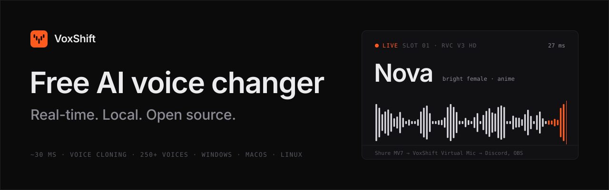
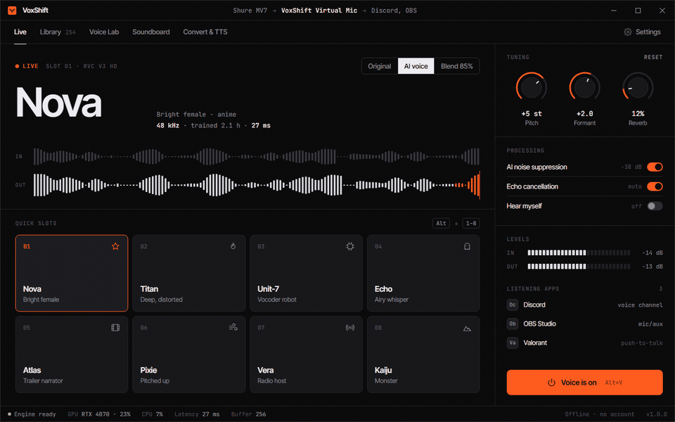
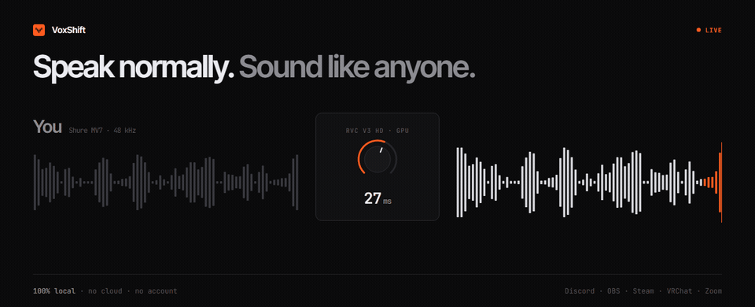
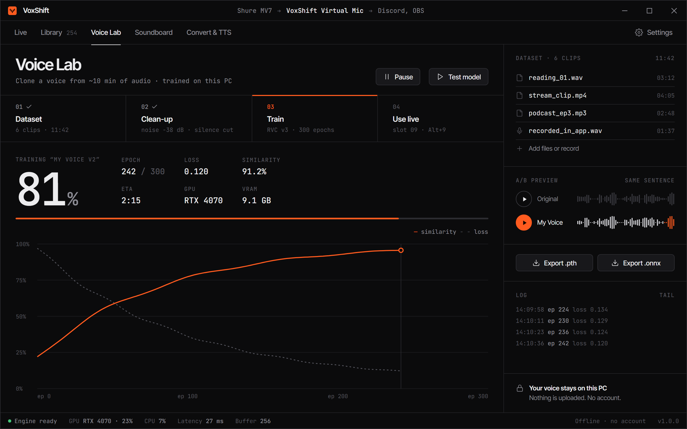
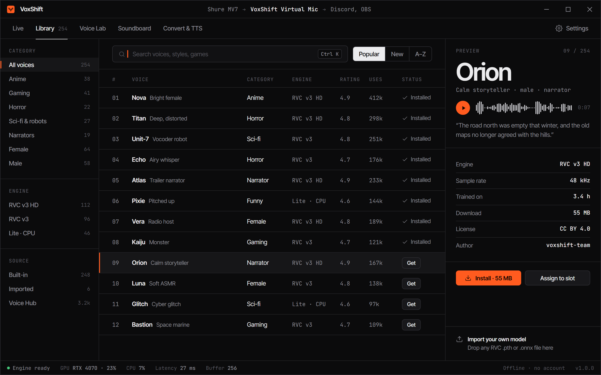
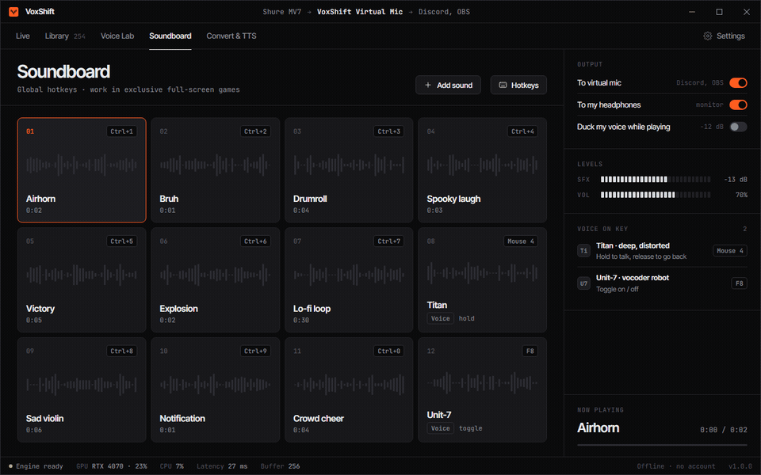
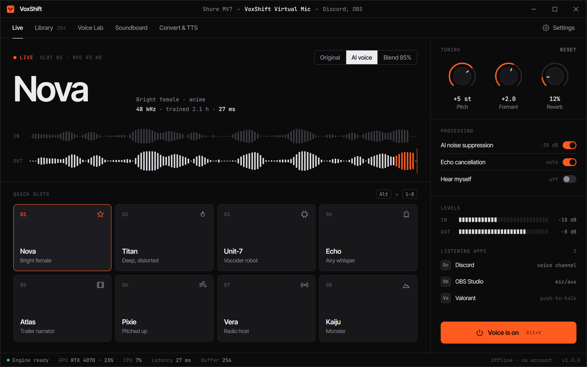
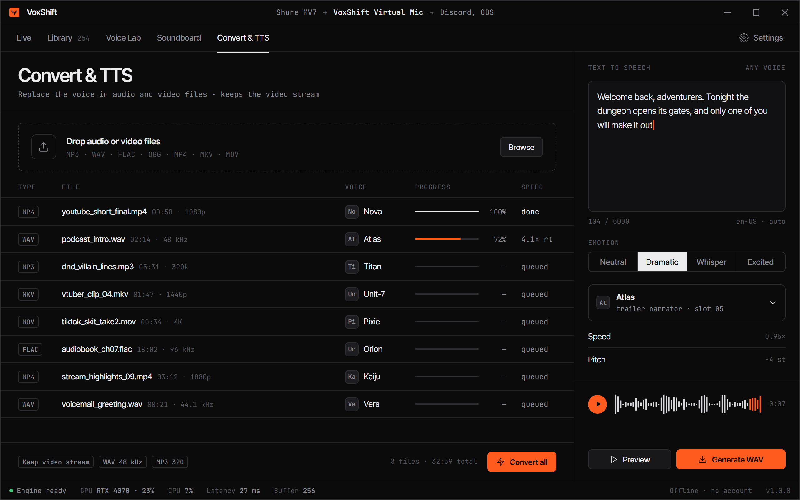
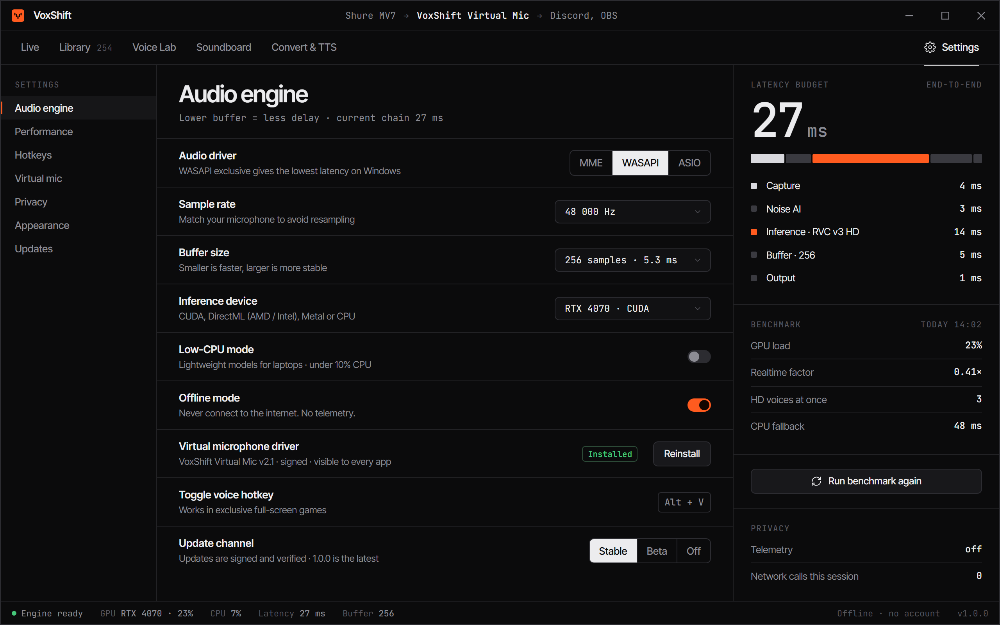
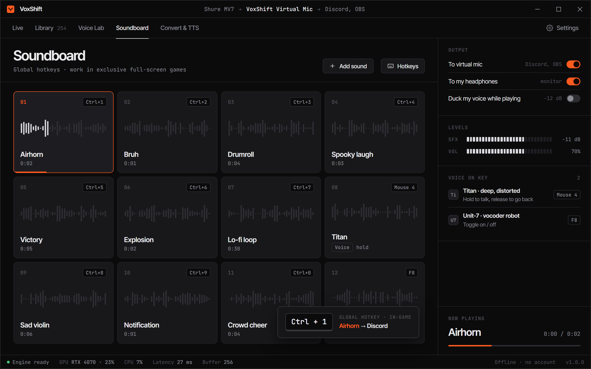

<h1>VoxShift — 免费 AI 变声器，支持 Windows、macOS 和 Linux</h1>

<b>实时 AI 变声器</b>，延迟约 30 ms，支持<b>本地声音克隆</b>、250+ 款免费音色、快捷键音效板，以及可用于 <b>Discord、OBS、Twitch、Zoom、Steam 和所有游戏</b>的虚拟麦克风。 
100% 免费 · 开源 · 离线运行 · 无需账号 · 无广告。

<a href="README.md">English</a> · <a href="README.es.md">Español</a> · <a href="README.ar.md">العربية</a> · <a href="README.hi.md">हिन्दी</a> · <b>简体中文</b> &nbsp;|&nbsp;
<a href="#killer-features">功能</a> ·
<a href="#download--install">安装</a> ·
<a href="#voxshift-vs-voicemod-clownfish-morphvox-voiceai">对比</a> ·
<a href="#faq">常见问题</a>

VoxShift 是一款适用于 Windows、macOS 和 Linux 的免费开源 AI 变声器，可实时（约 30 ms）改变你的声音，并通过虚拟麦克风将其发送到 Discord、OBS、Twitch、Zoom 和游戏中。

## 速览

| | **VoxShift** |
|---|---|
| 它是什么 | 实时 AI 变声器，支持本地声音克隆、音效板和虚拟麦克风 |
| 价格 | 免费：没有付费版本、广告、水印或时间限制 |
| 许可证 | MIT（开源） |
| 平台 | Windows 10 / 11 (x64, ARM64) · macOS 12+（Apple Silicon 和 Intel） · Linux（AppImage、`.deb`、Flatpak） |
| 离线 / 数据 | 支持离线。变声和声音克隆都在你的电脑上运行；无需账号，无遥测 |
| 主要功能 | 约 30 ms 神经网络变声 · Voice Lab 仅需约 10 分钟音频即可克隆声音 · 250+ 款音色 · 支持游戏内快捷键的音效板 · 文件变声与 TTS |
| 可替代 | Voicemod、Clownfish、MorphVOX Pro、Voice.ai |
| 版本 | 1.0.0 |

---

## 目录

- [为什么选择 VoxShift？](#why-voxshift)
- [核心功能](#killer-features)
- [截图](#screenshots)
- [下载与安装](#download--install)
- [快速上手（60 秒）](#quick-start-60-seconds)
- [VoxShift 对比 Voicemod、Clownfish、MorphVOX、Voice.ai](#voxshift-vs-voicemod-clownfish-morphvox-voiceai)
- [使用场景](#use-cases)
- [常见问题](#faq)
- [路线图](#roadmap)
- [技术栈](#built-with)
- [参与贡献](#contributing)
- [许可证与负责任使用](#license--responsible-use)

## 为什么选择 VoxShift？

大多数“免费”变声器要么是机械感十足的变调器，要么靠广告盈利，要么把好听的音色锁在订阅后面。**VoxShift 是一款真正听起来像真人的神经网络变声器——而且完全免费。**

- **听起来真实，而不是机器人。** RVC 级别的神经网络模型真正转换你的声音，而不只是变调——呼吸、情感和口音都能保留。
- **够快，竞技游戏也能用。** 在中端 GPU 上端到端延迟约 30 ms，在仅有 CPU 的笔记本上也低于 60 ms。
- **隐私优先的设计。** 所有处理（包括声音克隆）都在本地运行。无需账号，无遥测，可完全离线使用。
- **免费开源（MIT）。** 没有水印，没有时间限制，没有“高级音色”。所有功能都包含在免费版中。

## 核心功能

<table>
<tr>
<td width="50%" valign="top">

### 实时 AI 变声
正常说话即可——VoxShift 用神经网络模型实时重新合成你的声音。实时**延迟表**显示端到端延迟（使用 CUDA、DirectML 或 Apple Metal 时通常为 **25–35 ms**），**A/B 混合**功能可以把你的原声和 AI 声音按比例混合。

</td>
<td width="50%"></td>
</tr>
<tr>
<td width="50%"></td>
<td width="50%" valign="top">

### Voice Lab——在本地克隆你自己的声音
只需**约 10 分钟音频即可训练专属 AI 声音模型**。拖入录音、播客或直播回放——VoxShift 会清理数据集（去除噪音和静音），在你的 GPU 上训练，并提供 A/B 试听。**你的声音永远不会离开你的电脑**。可导出为 `.pth` / `.onnx`，或分享到社区中心。

</td>
</tr>
<tr>
<td width="50%" valign="top">

### 250+ 款免费 AI 音色
动漫少女、低沉恶魔、机器人、幽灵、电影预告片旁白、花栗鼠、电台主播、怪物、太空战士、ASMR 等等——全部免费，全部离线可用。一键浏览、试听和安装，也可以导入任意 **RVC `.pth` / `.onnx`** 模型。**Voice Hub** 还提供数千款社区音色。

</td>
<td width="50%"></td>
</tr>
<tr>
<td width="50%"></td>
<td width="50%" valign="top">

### 音效板 + 音色快捷键
专为玩家打造的音效板：**全局快捷键在全屏游戏中也能用**，音效会同时发送到你的麦克风*和*耳机，任意按键都可以**切换音色**——按住 <kbd>Mouse 4</kbd> 用恶魔的声音说话，松开即恢复原声。

</td>
</tr>
<tr>
<td width="50%" valign="top">

### 虚拟麦克风——任何应用都能用
一键安装已签名的 **VoxShift Virtual Mic** 驱动。在 Discord、OBS、Zoom、Teams、Steam、TeamSpeak、VRChat、Valorant、CS2 或 Fortnite 中将其选为输入设备即可——无需 Voicemeeter，也无需虚拟声卡线路设置。

### AI 降噪与回声消除
神经网络降噪会在变声*之前*去除键盘声、风扇声和房间回声，让 AI 声音保持干净——即使用的是便宜的耳机麦克风。

</td>
<td width="50%"></td>
</tr>
<tr>
<td width="50%"></td>
<td width="50%" valign="top">

### 文件变声与文字转语音
批量更改 **MP3、WAV、FLAC、MP4、MKV 和 MOV** 文件中的声音——视频画面保持不变，只替换人声。也可以输入文字，用**任意音色**和情绪（戏剧化、耳语、兴奋）生成 **TTS** 语音。适合 YouTube Shorts、TikTok、配音和 D&D 跑团。

</td>
</tr>
<tr>
<td width="50%" valign="top">

### 低 CPU 模式、离线、无需账号
轻量模型让笔记本和老电脑上的 CPU 占用**低于 10%**。离线模式会阻止所有网络请求。无需注册，无广告，无遥测——永远如此。

</td>
<td width="50%"></td>
</tr>
</table>

## 截图

<table>
<tr>
<td></td>
<td></td>
<td></td>
</tr>
<tr>
<td align="center"><b>实时变声</b> — 实时转换声音</td>
<td align="center"><b>音色库</b> — 250+ 款音色</td>
<td align="center"><b>Voice Lab</b> — 克隆你的声音</td>
</tr>
<tr>
<td></td>
<td></td>
<td></td>
</tr>
<tr>
<td align="center"><b>音效板</b> — 全局快捷键</td>
<td align="center"><b>文件变声与 TTS</b></td>
<td align="center"><b>设置</b> — WASAPI / ASIO</td>
</tr>
</table>

## 下载与安装

| 系统 | 安装包 | 命令 / 链接 |
|---|---|---|
| **Windows 10 / 11** (x64, ARM64) | 安装程序 `.exe` · 便携版 `.zip` | [VoxShift-Setup-1.0.0-x64.exe](https://github.com/ShardHazeGap/voxshift/releases/latest) |
| | winget | `winget install VoxShift.VoxShift` |
| | Scoop | `scoop bucket add extras && scoop install voxshift` |
| **macOS 12+**（Apple Silicon 和 Intel） | 通用版 `.dmg` | [VoxShift-1.0.0-universal.dmg](https://github.com/ShardHazeGap/voxshift/releases/latest) |
| | Homebrew | `brew install --cask voxshift` |
| **Linux** (x86_64) | AppImage · `.deb` · Flatpak | [VoxShift-1.0.0-x86_64.AppImage](https://github.com/ShardHazeGap/voxshift/releases/latest) · `flatpak install flathub app.voxshift.VoxShift` |

**系统要求**

| | 最低配置（低 CPU 模式） | 推荐配置（HD 音色，约 30 ms） |
|---|---|---|
| CPU | 4 核，2015 年及以后 | 6 核及以上 |
| GPU | 不需要 | NVIDIA GTX 1660 / RTX 20xx+、AMD RX 6000+ (DirectML)、Apple M1+ |
| 内存 | 4 GB | 8 GB+ |
| Voice Lab 训练 | — | 6 GB+ 显存 (NVIDIA) 或 Apple M 系列 |

> 每个版本都经过签名，并附带 SHA-256 校验值。请只从 [GitHub Releases](https://github.com/ShardHazeGap/voxshift/releases) 下载。

## 快速上手（60 秒）

1. **安装并启动 VoxShift**——安装向导会安装虚拟麦克风驱动，并对你的 GPU 进行性能测试。
2. 在 *Live Voice* 中**选择一个音色**（或按 <kbd>Alt</kbd> + <kbd>1</kbd>…<kbd>8</kbd>），然后点击 **Voice ON**。
3. **在 Discord / OBS / 游戏中**将输入设备设为 **`VoxShift Virtual Mic`**。完成。

<b>Discord 分步设置</b>

1. Discord → *用户设置* → *语音和视频*。
2. **输入设备** → `VoxShift Virtual Mic`。
3. **关闭** Discord 的*噪音抑制*和*回声消除*（VoxShift 的 AI 已经做得更好）。
4. 将*输入灵敏度*设为自动。开口说话——你的朋友听到的就是 AI 声音。

<b>OBS / Streamlabs 设置</b>

*来源* → *音频输入采集* → 设备选择 `VoxShift Virtual Mic`。将原始麦克风音源静音，避免声音重叠。

## VoxShift 对比 Voicemod、Clownfish、MorphVOX、Voice.ai

| | **VoxShift** | Voicemod | Clownfish | MorphVOX Pro | Voice.ai |
|---|:---:|:---:|:---:|:---:|:---:|
| 价格 | **免费 (MIT)** | 免费增值 / 订阅 | 免费 | 付费 | 免费增值 |
| 神经网络 AI 音色（非简单变调） | ✓ | Pro | — | — | ✓ |
| **本地**克隆你自己的声音 | ✓ | — | — | — | 云端 |
| 离线可用，无需账号 | ✓ | — | ✓ | ✓ | — |
| 开源 | ✓ | — | — | — | — |
| 内置音效板 + 音色快捷键 | ✓ | ✓ | — | 部分 | — |
| 音频/视频文件变声 | ✓ | — | — | 部分 | 部分 |
| 任意音色文字转语音 | ✓ | 部分 | ✓ | — | — |
| 导入 RVC `.pth` / `.onnx` 模型 | ✓ | — | — | — | 部分 |
| macOS 和 Linux | ✓ | macOS | — | — | — |
| 广告 / 付费推销 | **无** | 有 | 无 | 有 | 有 |

**在找免费的 Voicemod 替代品？** VoxShift 是 Voicemod、Clownfish、MorphVOX Pro 和 Voice.ai 的免费开源替代品——而且内置虚拟麦克风，连 Voicemeeter 也不需要了。

对比基于 v1.0.0 发布时的公开信息。商标归其各自所有者所有。发现错误？[提交 issue](https://github.com/ShardHazeGap/voxshift/issues)。

## 使用场景

### Discord 变声器
将 VoxShift 设为 Discord 的输入设备，通话中用快捷键随时切换音色。支持语音频道、Stage 频道和私信，Discord 自带的音效板也能和 VoxShift 的音效板同时使用。

### 直播变声器（OBS、Twitch、YouTube、Kick）
以角色身份直播，无需露脸——非常适合**不露脸主播和 VTuber**。将音色和音效绑定到 Stream Deck 或快捷键，并把虚拟麦克风接入 OBS。

### 游戏变声器（Valorant、CS2、Fortnite、Apex、GTA RP）
全局快捷键在独占全屏模式下也能用。低延迟意味着你的报点不会慢半拍。关键残局时按住一个键，瞬间切换成恶魔声音。GTA V RP 玩家用 VoxShift 保持始终如一的角色声音。

### VRChat 和 VTuber 变声器
为你的虚拟形象搭配可爱的动漫音色或低沉的怪物音色。在 Voice Lab 中克隆你角色的声音，并在 VRChat、Twitch 和 TikTok 上保持一致。

### 适用于内容创作者、播客主和配音
批量转换旁白配音，为采访嘉宾匿名变声，为动画、YouTube Shorts 和 TikTok 制作角色声音，或用文字转语音生成旁白。

## 常见问题

<b>VoxShift 真的免费吗？</b>

是的。VoxShift 基于 MIT 许可证免费开源。没有付费版本、广告、水印或时间限制。你可以通过 GitHub Sponsors 支持开发。

<b>如何免费在 Discord 上变声？</b>

安装 VoxShift，选择一个音色，点击 **Voice ON**，然后在 Discord → 语音和视频中将输入设备设为 **VoxShift Virtual Mic**。参见 [Discord 设置](#quick-start-60-seconds)。

<b>它是实时变声器吗？延迟有多少？</b>

是的。在 NVIDIA RTX / AMD RX 6000 / Apple M1 GPU 上，典型端到端延迟为 25–35 ms；低 CPU 模式下为 45–60 ms。应用内的延迟表会显示你的确切数值。

<b>可以克隆自己的声音吗？安全吗？</b>

可以——Voice Lab 用你约 10 分钟的音频训练模型。训练和推理完全在你的电脑上运行，不会上传任何内容。请只克隆属于你自己或已获得明确许可使用的声音。

<b>没有 GPU 也能用 VoxShift 吗？</b>

可以。低 CPU 模式使用轻量模型，任何现代 4 核 CPU 都能运行，占用低于 10%。有 GPU 则可解锁 HD 音色和更低的延迟。

<b>在 Valorant、CS2 或 Fortnite 里用变声器会被封号吗？</b>

不会。VoxShift 不会触碰游戏进程——它只是一个标准的音频输入设备，就像 USB 麦克风一样。它不涉及反作弊问题。

<b>可以使用网上下载的 RVC 模型吗？</b>

可以。通过 *Voice Library → Import* 导入任意 RVC v1/v2 `.pth` 或 `.onnx` 模型。请遵守每个模型的许可协议。

<b>支持 macOS 和 Linux 吗？</b>

支持。macOS 12+（Apple Silicon 使用 Metal 加速），Linux 可通过 AppImage、`.deb` 或 Flatpak 使用（PipeWire / PulseAudio 虚拟音源）。

<b>VoxShift 能替代 Voicemod 吗？</b>

能——VoxShift 涵盖 Voicemod 的核心功能（实时音色、音效板、快捷键、虚拟麦克风），并额外提供本地声音克隆、文件变声和 TTS，免费且无需账号。

<b>如何更改视频文件中的声音？</b>

打开 *Converter & TTS*，拖入 MP4/MKV/MOV 文件，选择一个音色，然后点击 **Convert all**。VoxShift 会保留原始视频，只替换人声音轨。

## 路线图

- [x] 实时 RVC v3 引擎（CUDA、DirectML、Metal、CPU）
- [x] Voice Lab——本地声音克隆
- [x] 支持全局快捷键和按键切换音色的音效板
- [x] 文件变声 + 文字转语音
- [ ] Stream Deck 和 Touch Portal 插件
- [ ] 实时唱歌模式（音准精确）
- [ ] Android 配套应用（远程音效板）
- [ ] 仅需 10 秒音频的零样本声音克隆
- [ ] 翻译模式——说英语，听起来像在说日语

欢迎在 [Discussions](https://github.com/ShardHazeGap/voxshift/discussions) 中为功能投票。

## 技术栈

UI 设计源文件位于 `design/`——本 README 中的所有截图和 GIF 均由其渲染生成。

## 参与贡献

欢迎提交 PR、新音色和翻译。请阅读 [CONTRIBUTING.md](CONTRIBUTING.md)，挑选一个 [`good first issue`](https://github.com/ShardHazeGap/voxshift/labels/good%20first%20issue)，并加入我们的 [Discord](https://github.com/DISCORD_INVITE)。

### Star 历史

## 许可证与负责任使用

VoxShift 基于 [MIT 许可证](LICENSE) 发布。

变声和声音克隆是强大的工具。**请勿**使用 VoxShift 在未经同意的情况下冒充真实人物、实施欺诈、骚扰他人或绕过基于声音的身份验证。请只克隆属于你自己或已获得明确许可使用的声音。你有责任遵守你所在国家/地区的法律。

---

**如果 VoxShift 对你有帮助，请给仓库点个 Star。这能帮助更多人找到免费的变声器。**

关键词：免费变声器 · AI 变声器 · 实时变声器 · Discord 变声器 · 电脑变声器 · RVC 变声器 · 声音克隆 · AI 声音克隆 · 动漫变声器 · 音效板 · Voicemod 替代 · 游戏变声器 · 直播变声 · 免费开源变声器（Windows、macOS、Linux） · voice changer

